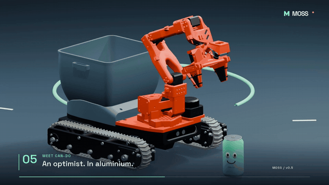

# MOSS

Cleaner streets, one maker at a time.

> **MOSS kits are coming soon on [TNKR](https://tnkr.ai/).**
> Skip printing and sourcing the parts yourself. **[Join the waitlist →](https://ak4khuvxkya.typeform.com/to/qaKmXNME)** to be notified when kits are available.

**[Build guide](https://www.showrobotics.ai/moss/build/) · [Print parts](https://www.showrobotics.ai/moss/build/#print) · [Bill of materials](BOM.md) · [Download CAD, STL & 3MF](https://github.com/metrox-eth/moss/releases/download/v0.6-r92/MOSS_R92_Mechanical_20261024.zip) · [Software setup](Software.md)**

MOSS is a small litter-picking rover you print and build yourself: a tracked base, a bin on top, an arm derived from the SO-101 with a parallel gripper. It is open hardware, built in public, and meant to be built by many hands.

**Where it stands.** The physical rover drives and demonstrates pick-and-drop motions. Autonomous litter picking and the full field test are not yet demonstrated. The V0.6 / R92 CAD, STL files, BOM and assembly guide are now available.

## Build options

**Base assembly: about $460 in parts.** Includes the chassis and tracks, arm and gripper, motors, servos, control electronics, power system, wrist camera, 2D lidar, wiring and filament. **Only the computer and navigation camera are additional.**

Add **one** configuration: **Jetson + RealSense**, **or Pi + Hailo + Gemini**, **or Pi + Mighty**.

| Choose one computer + navigation camera configuration | Additional cost above the base (USD) |
|---|---:|
| Jetson Orin Nano Super, RealSense D455 | about $930 |
| Raspberry Pi 5, Hailo AI HAT, Orbbec Gemini 2 | about $740 |
| Raspberry Pi 5, Mighty camera | about $400 |

These option prices exclude the $460 base assembly. The [BOM](BOM.md) lists the components and hardware for each option.

## What it is made of

- Tracked base, two geared DC motors with encoders, printed TPU tracks, an ESP32-S3 driving the motors.
- A bin you empty by hand at the end of a run.
- An SO-101 arm (open source) with a NormaCore parallel-jaw gripper, widened to a 90 mm grip.
- Two cameras: a depth camera at the nose, a colour camera in the hand.
- A 2D lidar for navigation.
- Software: dimOS for teleop, recording, navigation and manipulation.

I pick up litter by hand on my walks. MOSS is the robot I want next to me doing the same. One less can on the ground.

## News

- 24 October 2026: **BOM and print plates updated.** Hoco HB1 four-port hub, GameSir Nova 2 Lite controller, all 38 spacers on one plate, and one tensioner-slider reference (print four). [Updated package](https://github.com/metrox-eth/moss/releases/download/v0.6-r92/MOSS_R92_Mechanical_20261024.zip) · [Print plates](https://www.showrobotics.ai/moss/build/print-plates.html).
- 18 October 2026: **Ready-to-print plates are available.** [H2S: one-piece hull and cover](https://github.com/metrox-eth/moss/releases/download/v0.6-r92/MOSS_V06_R92_H2S_Print_Plates.3mf) or [P1 / P2: split hull and cover](https://github.com/metrox-eth/moss/releases/download/v0.6-r92/MOSS_V06_R92_256mm_Split_Print_Plates.3mf). The [updated package](https://github.com/metrox-eth/moss/releases/download/v0.6-r92/MOSS_R92_Mechanical_20261018.zip) includes both Jetson retaining tabs, grouped STLs with quantities, and both 3MF projects. [Choose your plates](https://www.showrobotics.ai/moss/build/print-plates.html).

- 16 October 2026: **V0.6 / R92 is available.** [Build guide](https://www.showrobotics.ai/moss/build/), [CAD & STL package](https://github.com/metrox-eth/moss/releases/tag/v0.6-r92) and [BOM](BOM.md). One-piece and two-piece hull/cover options, modular computer and camera carriers, and short assembly videos.

- 15 October 2026: [MOSS Core V1D routed PCB draft](hardware/electronics/moss-core-v1d/): integrated audio and switched motor/servo power, published for review. Untested and not approved for fabrication. [V1C critical erratum](hardware/electronics/moss-core-v1d/V1C_CRITICAL_ERRATA.txt): do not fabricate V1C.
- 14 October 2026: [CAD development with Codex](docs/cad-with-codex.md): more battery room, integrated audio, a slimmer hull, a P1S split-hull option and deeper track guides. Images and geometry checks; physical validation is next.
- 3 October 2026: V0.6 makes the hardware modular, Pi or Jetson, RealSense or Gemini. Waitlist open with Tnkr.
- 1 October 2026: V0.5, the release candidate for the open source CAD.
- 26 September 2026: arm and gripper mounted on the prototype.
- 22 September 2026: first drive.

## Friends

OpenAI (Codex Physical Builds), [Dimensional](https://x.com/dimensionalos) (dimOS), [NormaCore](https://x.com/norma_core_dev) (gripper), [Tnkr](https://x.com/tnkrdotai) (kits and guide), [Dirac Robotics](https://x.com/diracrobotics) (calibrated simulation), [microduck-lab](https://github.com/jonathanhawkins/microduck-lab) (reinforcement learning). We help each other.

## Supporters

People who put a spool of filament in the rover every month: [Richard Burton](https://github.com/ricburton). It goes into parts the same week. You can join them on [GitHub Sponsors](https://github.com/sponsors/metrox-eth).

## Simulation and autonomy, work in progress

The current **[MOSS V0.6 / R92 MuJoCo model](simulation/mujoco/)** lives in this repository, with its XML, meshes, viewer and tests. It includes the released assembly geometry, an articulated arm and coupled gripper, and an idealized base that can drive and turn. It runs locally without Jev or an API key. Start with the **[simulation guide](simulation/mujoco/README.md)** or **[model files](simulation/mujoco/model/)**.

This is a preliminary development model: traction, servo dynamics, camera geometry and sim-to-real accuracy remain uncalibrated. Dirac Robotics is helping build the calibrated simulation; Dimensional is working on a navigation arena, and microduck-lab is trying reinforcement learning. The earlier recorded Jev demonstration remains in [moss-jev](https://github.com/metrox-eth/moss-jev) as historical work.

## Come and build

Ask anything, tell us what we are doing wrong, it helps the next builder: [Discord](https://discord.com/invite/x2MeNmgveT). The build, as it happens: [@metrox_eth](https://x.com/metrox_eth). The story so far, in a few moments: [STORY.md](STORY.md). How data from many rovers gets pooled: [docs/data.md](docs/data.md).

## Safety

This is a prototype with a lithium battery and no certified protection. Put it on blocks for the first run. Build at your own risk.

## License

Code under Apache-2.0. Hardware files under CERN-OHL-S-2.0. Documentation and media under CC BY 4.0. See `NOTICE`.
