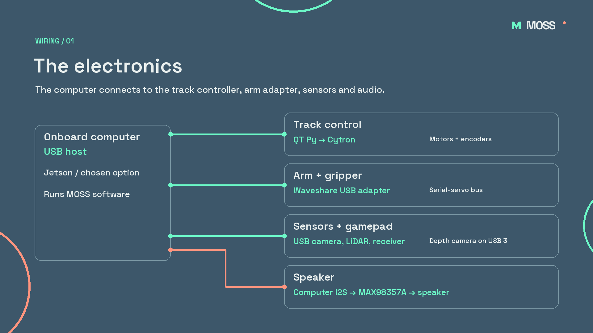
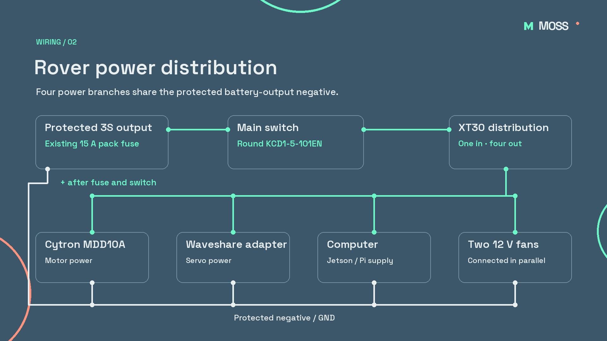
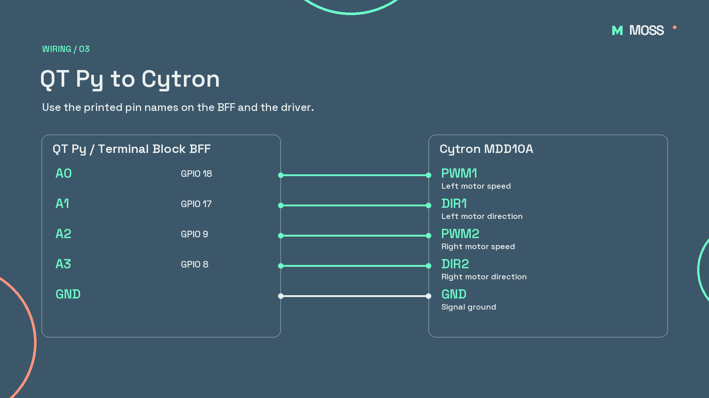
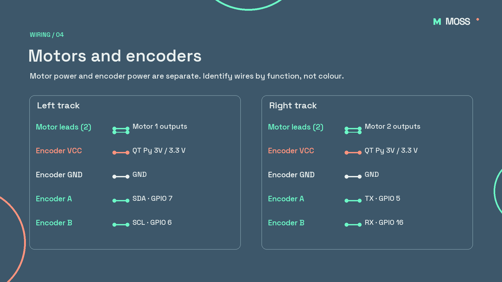
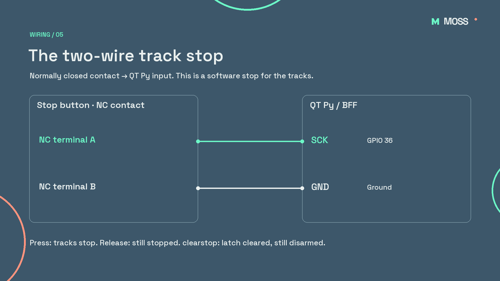
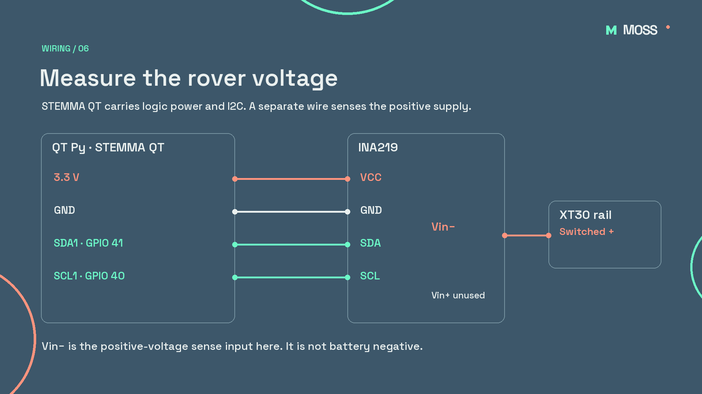
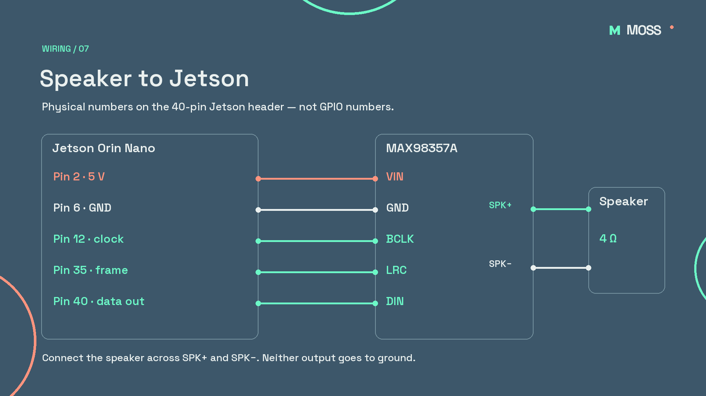
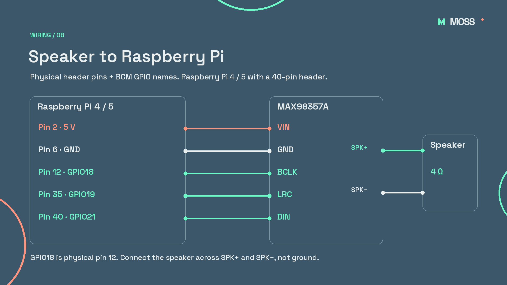

# MOSS wiring

This guide explains how to connect the electronics listed in the MOSS BOM. The computer talks over USB to a QT Py motor controller and a Waveshare servo adapter. The Cytron MDD10A drives the tracks; the Waveshare adapter controls the arm and gripper.

Use this page after mounting the electronics and before closing the hull. Follow the [mounting steps](https://github.com/metrox-eth/moss/blob/main/docs/build/ASSEMBLY.md#hull-electronics-and-sensors) for component positions. Left and right mean the rover's left and right when facing forward.

## 1. Identify the modules

| Module | What it does |
|---|---|
| Onboard computer | Runs the MOSS software and connects the USB devices |
| Adafruit QT Py ESP32-S3, ref. 5426, on Terminal Block BFF, ref. 6495 | Sends motor commands and reads the track encoders |
| Cytron MDD10A Rev2 | Supplies the two drive motors |
| Adafruit INA219, ref. 904 | Reports battery voltage in this configuration |
| Waveshare Bus Servo Adapter A | Connects the arm and gripper to the computer over USB |
| MAX98357A | Drives the speaker from the computer's digital audio output |

The tables here use the QT Py's printed pin names, such as A0 and SDA. GPIO numbers are included to distinguish them from other ESP32 boards. These connections apply to the QT Py ESP32-S3 listed above.

## 2. Prepare the power connections

Keep the battery and charger disconnected while making connections. The rover supply and charging inlet are separate branches: the rover uses XT30; the charging inlet uses the matching barrel connectors.

| Connection | Requirement for this build |
|---|---|
| Battery output | Protected 3S Li-ion output; up to 12.6 V when fully charged |
| Main fuse | Existing 15 A pack fuse, close to battery positive |
| Main switch | KCD1-5-101EN, 20 mm opening; selected listing specifies 20 A at 12 V DC |
| Power distribution | XT30 enclosure: one input and four outputs; label each branch |
| Cytron power input | Battery-voltage motor branch; identify Vmotor + and − on the actual driver |
| Jetson computer branch | For the documented Orin Nano developer-kit carrier: 5.5 × 2.5 mm plug, 9.5 mm barrel, centre positive |
| Raspberry Pi computer branch | Use a suitable regulated 5 V supply for the Pi; battery voltage must not go directly to its USB-C input |
| Servo branch | Separate DC power into the Waveshare adapter, matched to the installed servos; USB supplies communication, not the servo load |
| Charging connection | DC099 rear socket and both cable assemblies: 5.5 × 2.1 mm, at least 18 AWG copper leads, complete contacts and cable rated for 5 A continuous |

The [battery and charging guide](https://github.com/metrox-eth/moss/tree/main/hardware/power/custom-3s4p-battery#rear-charging-port-and-cable) contains the charge-path drawing and main-switch connections. A commercial assembled battery does not require the cell-building steps: start with its protected output and a charger suitable for that pack.

Wire the two 12 V fans in parallel on the fourth branch. Connect every branch's negative to the protected battery-output negative, through the distribution return. On the custom common-port battery this is the BMS's **C− output**, not the raw cell negative.

The round main switch is the separate control that disconnects the rover's supply. Connect fused battery positive to its power input, its switched power output to the XT30 positive rail, and its LED-return terminal to protected output negative. Identify those functions from the switch markings or a continuity check before wiring; the LED terminal is not a power output.

The stop button is a low-current input to the QT Py, described in section 5 below. Do not put it in series with the motor or whole-rover power wiring.

[Watch the power-distribution assembly](https://raw.githubusercontent.com/metrox-eth/moss/main/docs/build/videos/07-xt30-power-distribution.mp4).

## 3. Connect the QT Py to the Cytron

Use the QT Py/BFF labels in the first column and the Cytron's input labels in the second. Identify labels on the boards rather than counting pins from a photograph that might be flipped.

| QT Py / BFF | GPIO | Cytron MDD10A input | Function |
|---|---:|---|---|
| A0 | 18 | PWM1 | Left motor speed |
| A1 | 17 | DIR1 | Left motor direction |
| A2 | 9 | PWM2 | Right motor speed |
| A3 | 8 | DIR2 | Right motor direction |
| GND | — | Signal GND | Shared signal reference |

Connect the left motor's two power wires to motor channel 1 and the right motor's to channel 2. Encoder wires belong to the next table; they do not go on the motor output terminals.

The MDD10A accepts 3.3 V PWM/DIR signals. Its battery input has no reverse-polarity protection, so check the power connector before plugging it into the driver. See the [Cytron product documentation](https://www.cytron.io/p-10amp-5v-30v-dc-motor-driver-2-channels).

Use the **MDD10A firmware build**, even though the source folder still has MDD3A in its name. The compile option is `-DMOSS_DRIVER_MDD10A`; [the build command is here](https://github.com/metrox-eth/moss/blob/main/firmware/MOSS_QTPY_MDD3A/bench/README.md).

## 4. Connect the motor encoders

| Encoder signal | QT Py / BFF | GPIO |
|---|---|---:|
| Left A | SDA | 7 |
| Left B | SCL | 6 |
| Right A | TX | 5 |
| Right B | RX | 16 |
| Both encoder VCC connections | 3V / 3.3 V | — |
| Both encoder GND connections | GND | — |

In this firmware, SDA/SCL and TX/RX are encoder inputs. They are not being used as their usual I2C and serial interfaces.

Power the encoders from the QT Py's **3V / 3.3 V** output, independently of the motors' 12 V power wires. The Hall-encoder version used by this guide must support a 3.3 V supply and 3.3 V output signals. An encoder that requires 5 V needs a separately documented interface; do not put its 5 V outputs directly on QT Py inputs.

Identify the six motor wires by their functions: two motor-power leads, encoder VCC, encoder GND, A and B. Vendors use different wire colours and connector orders. Follow the markings or diagram supplied with the actual motor; the drawing above is a connection list, not a numbered plug orientation. Check each track and its encoder direction during the first test.

For comparison, [this JGB37-520 family supplier lists 3.3–5 V encoder power](https://www.dowin.com/corp/detail-uuu5cbf-pudwcye-600rpm-24v-small-dc-gear-motors-with-hall-encoder.html). It is not a universal colour or connector standard.

## 5. Connect the two-wire track stop button

This connection uses the **normally closed (NC)** contact of the latching LA16 button. It stops the tracks through the QT Py firmware. It does **not** disconnect motor power or stop the arm, and it depends on the controller running correctly.

| Button connection | QT Py / BFF |
|---|---|
| One terminal of the NC contact pair | SCK, GPIO 36 |
| Other terminal of the same NC pair | GND |
| Normally open (NO) contact and any lamp terminals | Unused; insulate separately |

With no power connected, use continuity mode to identify the NC pair: closed when the button is released, open when pressed and latched. Do not choose terminals just by their location or a seller photograph. The two wires on the NC pair have no polarity. Route them together, away from the motor-power wires.

Install the **`qtpy-mdd3a-v5` firmware, built for MDD10A**, before expecting the button to work. It enables the input's pull-up. A button press, open wire or disconnected contact opens the loop and latches a stop. Motor PWM and ramp state are reset to zero; normal `arm`, `drive` and timed-test commands cannot override the latch. Earlier firmware does not implement this input.

To recover after a stop:

1. Stop the teleoperation/navigation stack with `tools/moss-fly.sh stop` and centre the gamepad sticks.
2. Release the physical button. The NC loop must remain closed for at least 100 ms.
3. From the robot's checkout, run `.venv/bin/python firmware/MOSS_QTPY_MDD3A/bench/moss_bench.py "clearstop"`. This clears the latch but leaves the firmware disarmed.
4. Run `tools/moss-fly.sh check`, then restart teleoperation deliberately. The host's usual arming sequence can now run.

The new stop support has been compiled and checked with host tests; installation on the physical rover still requires the supported-track test in section 10. Pressing and then releasing the button must not restart a track by itself.

## 6. Connect the battery-voltage sensor

Connect the INA219 to the QT Py's **STEMMA QT connector** with the four-wire STEMMA cable. This connector uses a separate I2C bus; leave the BFF's SDA/SCL encoder terminals as connected above.

| QT Py STEMMA QT | INA219 connection |
|---|---|
| 3.3 V | Logic power |
| GND | Logic ground |
| SDA1, GPIO 41 | SDA |
| SCL1, GPIO 40 | SCL |

The firmware uses `Wire1`, address `0x40`, and reports voltage only. Motor current must not be routed through the INA219 module's small shunt as part of this installation.

For a voltage-only installation, connect the INA219 screw terminal marked **Vin−** to the **positive rail at the XT30 distribution, after the pack fuse and main switch**. Use a short, secured copper sense lead, 18 AWG in this harness. Leave Vin+ unused. The sensor's ground reference comes through STEMMA QT to the common protected-output ground.

**Vin− is not battery negative.** It is the negative side of the module's current-sense shunt; the chip measures bus voltage from this terminal to GND. In this voltage-only wiring it is connected to the positive voltage being measured. Do not connect the 12 V rail to the sensor's logic-power VIN/VCC pin.

The four main power branches bypass the INA219 shunt. The displayed reading is the rover's switched supply voltage at the distribution, which can differ slightly from a reading directly on the pack under load. Compare it with a multimeter at that same node. See [the INA219 datasheet, bus-voltage measurement](https://www.ti.com/lit/ds/symlink/ina219.pdf).

Reference: [QT Py pinout](https://learn.adafruit.com/adafruit-qt-py-esp32-s3/pinouts) and [INA219 pinout](https://learn.adafruit.com/adafruit-ina219-current-sensor-breakout/pinouts).

## 7. Connect the arm and gripper

1. Connect the Waveshare Bus Servo Adapter A to the computer with a USB data cable and set its control-mode selector for USB operation.
2. Connect its separate DC input to the servo-power branch. The adapter specifies a 9–12.6 V input, matched to the installed servos, and uses a 5.5 × 2.1 mm DC socket. Check polarity on the actual adapter and cable.
3. Connect the arm and gripper using their serial-servo bus cables. Follow the connector markings for supply, ground and data; keep the cables clear of the joints.
4. Assign a unique ID to each servo before commanding the assembled arm. Use the [arm setup and calibration instructions](https://github.com/metrox-eth/moss/blob/main/docs/arm.md) for the original SO-101 configuration.

The SO-102 variant needs its own joint/ID and calibration instructions; the original SO-101 servo table must not be presented as the SO-102 setup.

Reference: [Waveshare adapter documentation](https://docs.waveshare.com/Bus_Servo_Adapter_A).

## 8. Connect the USB devices

| Computer connection | Device |
|---|---|
| USB data | QT Py motor controller |
| USB data | Waveshare servo adapter |
| USB data | RPLIDAR C1, using its interface cable |
| USB data | Wrist camera |
| USB | GameSir wireless receiver |
| Suitable USB 3 port | Selected depth camera and its matching cable |

Plan for **six device connections** with this full configuration. A hub can provide additional ports, but it is an option for the chosen computer, not a mandatory common part. Check its power budget and fit in the hull. A USB 2 hub does not provide a USB 3 connection for the depth camera.

The MDD10A is connected to the QT Py, not directly to a computer USB port. The arm servos likewise connect to their adapter, not individually to USB.

## 9. Connect the speaker

### Jetson Orin Nano

This table uses **physical pin numbers on the Jetson's 40-pin header**, not GPIO numbers. It describes the I2S2 setup recorded for the Orin Nano developer kit under JetPack 6.

| Jetson connection | MAX98357A label |
|---|---|
| Physical pin 12, I2S2 bit clock | BCLK |
| Physical pin 35, I2S2 frame clock | LRC / LRCLK |
| Physical pin 40, I2S2 data out | DIN |
| Physical pin 2, 5 V supply | VIN / VDD |
| Physical pin 6, ground | GND |

Connect the 4 Ω speaker across **SPK+ and SPK−**, using the module's printed output labels. Neither speaker output is a ground connection. The amplifier receives 5 V here, not battery voltage. The [MAX98357A pinout](https://learn.adafruit.com/adafruit-max98357-i2s-class-d-mono-amp/pinouts) describes the supply, digital inputs and bridged speaker output.

The [NVIDIA carrier-board specification, expansion header](https://developer.nvidia.com/downloads/assets/embedded/secure/jetson/orin_nano/docs/jetson_orin_nano_devkit_carrier_board_specification_sp.pdf) labels these signals I2S0. The existing JetPack audio setup uses the I2S2 name; the physical header numbers above identify the wires in either case.

Then follow [the Jetson audio setup](https://github.com/metrox-eth/moss/blob/main/Software.md#speaker-on-the-jetsons-i2s) to enable I2S2 and test playback.

### Raspberry Pi 4 / 5

Use the Raspberry Pi's **40-pin header**. The physical pin positions for these five connections happen to match the Jetson above; the GPIO names and audio configuration are different. Locate pin 1 on the actual board before counting pins.

| Raspberry Pi physical pin | BCM GPIO / function | MAX98357A label |
|---|---|---|
| 2 | 5 V supply | VIN / VDD |
| 6 | Ground | GND |
| 12 | GPIO18, I2S bit clock | BCLK |
| 35 | GPIO19, I2S frame clock | LRC / LRCLK |
| 40 | GPIO21, I2S data out | DIN |

**GPIO18 means physical pin 12, not pin 18.** Connect the speaker across SPK+ and SPK−, with neither output connected to ground. Power the amplifier from 5 V, never from the rover's battery voltage, and allow at least 500 mA of additional capacity in the Pi's 5 V supply for the amplifier.

Follow [Adafruit's Raspberry Pi audio setup](https://learn.adafruit.com/adafruit-max98357-i2s-class-d-mono-amp/raspberry-pi-usage) for the operating-system configuration and playback test. The Jetson's I2S2 commands do not apply to Raspberry Pi OS. The Orange Pi needs its own pinout and audio setup.

Sources: [Adafruit MAX98357A Raspberry Pi wiring](https://learn.adafruit.com/adafruit-max98357-i2s-class-d-mono-amp/raspberry-pi-wiring), [Raspberry Pi header layout](https://www.raspberrypi.com/documentation/computers/raspberry-pi.html#gpio), and [Raspberry Pi I2S GPIO assignments](https://pip-assets.raspberrypi.com/categories/1259-audio-camera-and-display/documents/RP-009699-WP-1-Using%20the%20I2S%20peripherals%20on%20Raspberry%20Pi%20SBCs.pdf).

## 10. Check and test one part at a time

1. With battery and charger disconnected, inspect the finished connections, confirm polarity and check for unintended shorts between supply and ground. Secure the cables away from tracks, fans and arm joints.
2. Check the stop button's NC contact and its SCK-to-GND loop. With v5 firmware, `status` reports `stop_open` and `stop_latched`; both must be false before driving.
3. Power and identify the computer and USB boards first. Check that the QT Py firmware banner reports `driver mdd10a`.
4. Support the rover with both tracks clear. Use the [one-second motor tests](https://github.com/metrox-eth/moss/blob/main/firmware/MOSS_QTPY_MDD3A/bench/README.md), one track at a time, and verify direction and encoder changes. Press the stop button during each test: the track must stop, remain stopped after button release and reject another test until `clearstop`. Check the same behaviour with either stop-loop wire unplugged.
5. Scan the servo bus and confirm IDs before trying a small arm movement in clear space. Follow the arm-specific calibration procedure.
6. Check the cameras, LiDAR, controller and speaker. Follow [Software setup](https://github.com/metrox-eth/moss/blob/main/Software.md) for device configuration and the first teleoperation run.

The `tools/moss-fly.sh check` software check reads the stop flags when the firmware provides them. It does not verify power polarity, cable ratings or the button's physical response.

[Back to mounting instructions](https://github.com/metrox-eth/moss/blob/main/docs/build/ASSEMBLY.md) · [BOM](https://github.com/metrox-eth/moss/blob/main/BOM.md) · [Software setup](https://github.com/metrox-eth/moss/blob/main/Software.md)
