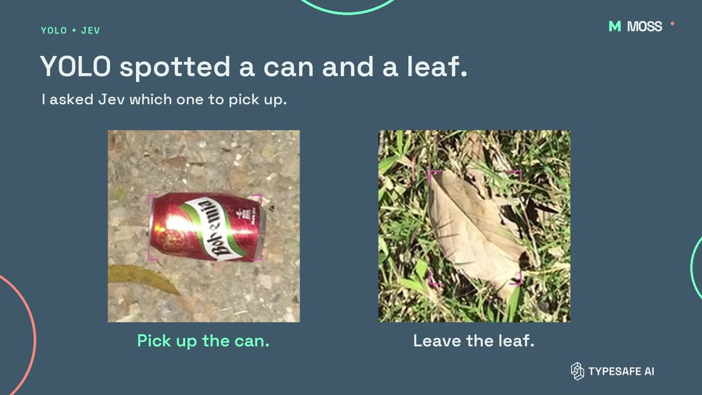

# Should MOSS pick it up?

YOLO spotted a drinks can and a dry leaf. I’d pick up the can and leave the leaf. I wanted to see whether Jev could make that call before MOSS, the litter-picking rover, reached for anything.

[](https://raw.githubusercontent.com/metrox-eth/moss/main/experiments/litter-pick-or-pass/media/pick-or-pass.mp4)

[Watch or download the 33-second video](https://raw.githubusercontent.com/metrox-eth/moss/main/experiments/litter-pick-or-pass/media/pick-or-pass.mp4) · [Photo credits](media/credits.md)

### What I tried

A fine-tuned YOLO11n segmentation model outlined objects in outdoor photos. For each proposed object, I cropped the surrounding area, marked the target with four pink corners and asked Jev 1.14.0 whether MOSS should pick it up. A score of 0.90 or higher counted as a yes. The red can scored **0.97** and the leaf **0.02**. [Original can crop](examples/can.jpg) · [Original leaf crop](examples/leaf.jpg)

I checked **258 crops from 108 TACO photos**. Jev said yes to **86 of 146** labeled litter crops. It said yes to **0 of 73** checked non-litter crops, including 29 proposals from empty background regions. Another 39 crops had no overlapping annotation and weren't verified, so I left them out of those two counts. This measures what happens after YOLO spots something. Litter YOLO misses never reaches Jev. [TACO dataset](https://github.com/pedropro/TACO)

### Trying again

I started with 50 litter photos and 10 decoys. A yes retired that place in the test. For every no, the next round used a crop from a **different source photo** of the same kind (litter or decoy). Here are the running totals.

| After round | 1 | 2 | 3 | 4 | 5 |
| --- | ---: | ---: | ---: | ---: | ---: |
| Litter marked for pickup (goal 50) | 29 | 45 | 48 | 49 | 49 |
| Decoys marked for pickup | 0 | 0 | 0 | 0 | 0 |

The smaller trial reached 9 out of 10 in the first round and stayed there. All five decoys stayed out.

These were photo tests. **49 out of 50** counts how many places filled after retries with fresh examples. The bin drop in the video was teleoperated. Next I want to drive past the **same wrapper** from two angles and see whether a second look helps.

### Try it

Run the following command from this folder to replay every round from the recorded scores. Python 3 is all it needs.

```sh
python3 replay.py
```

The [data file](data/pilot.json) includes the crop IDs, source photo IDs, labels, crop hashes, scores and the fixed order used to draw replacements. To try a **live** Jev decision, install Pillow, set your own `TYPESAFE_API_KEY` in the environment and run `python3 score_crop.py examples/leaf.jpg`. This sends the marked crop to TypeSafe. [Exact question and request](score_crop.py)
