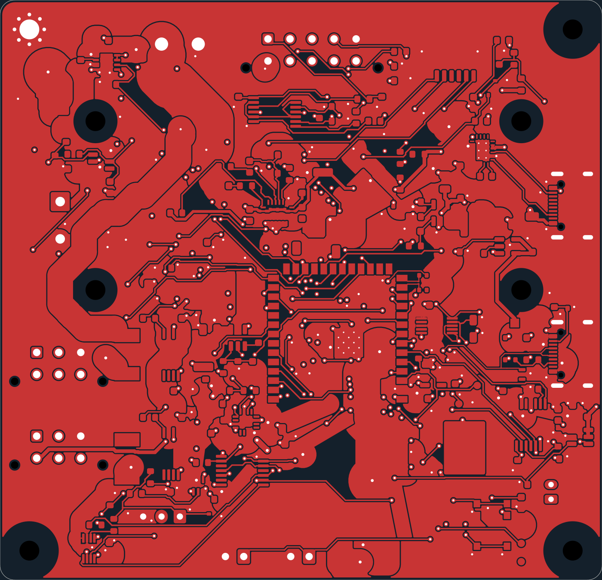
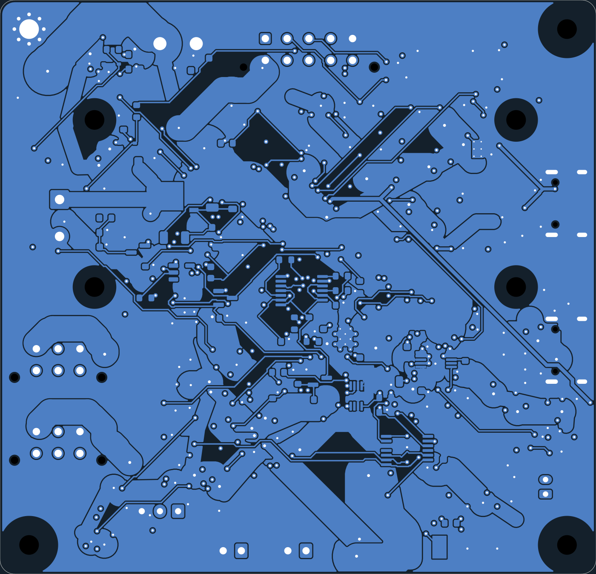

# Trying Zap on MOSS Core

**5 November 2026. Experimental routing comparison, not a new hardware revision.**

Could [Zap](https://zap.mutual.solutions/) improve the routing of MOSS Core V0.7? This test gives it a copy of the existing board, with the components already placed, and asks it to route the connections again.

**For this first run, the existing layout stays.** Zap returned a board in about six minutes, but left 29 connections unfinished. The original has none. The returned board is here for inspection, not fabrication.

## What came back

Both boards were checked locally with KiCad 10.0.6, the same project settings and the complete original custom rules, after refilling the copper zones.

| Local check | Existing layout | Zap result |
| --- | ---: | ---: |
| Missing connections | 0 | 29 |
| Copper joins narrower than the 0.15 mm minimum | 0 | 3 |
| Other warnings | 2 | 1 |
| Vias | 544 | 442 |
| Total track length | 6.17 m | 3.81 m |

The shorter tracks and lower via count are not a win on their own: the result is incomplete, and Zap also replaces some tracks with copper pours.

The unfinished connections include USB data, the right motor return, current-sense inputs and some ground and control connections. The three narrow joins measure 0.1097, 0.1225 and 0.1178 mm. Zap also changes part of C21's silkscreen, which produces a footprint-library warning.

Component positions, pad geometry and net assignments, the board outline, all eight keepouts and the four-layer count were preserved. Zap rebuilt the copper pours, adding ground and power areas on several layers, including switching nodes.

### Front copper

| Existing layout | Zap trial — incomplete |
| --- | --- |
|  |  |

### Back copper

| Existing layout | Zap trial — incomplete |
| --- | --- |
|  |  |

These are copper-layer views exported from KiCad, not fabrication previews or pictures of assembled boards.

## How the test was run

- Input: 230 footprints, 806 pads and 170 nets on an 82 × 79 mm, four-layer board.
- Source: [MOSS Core at commit `2af4606`](https://github.com/metrox-eth/moss/tree/2af4606d4aace74b695e0066c2827f3f6efe7f99/hardware/electronics/moss-core-v0.7).
- Zap stable router `r36a991d.6a78b6e8`, normal effort, a ten-minute budget and the board's own fabrication rules. Existing routing was stripped on the copy.
- The service reports five attempts, three completed, and returned attempt 3 after 359.3 seconds.
- Rail sizing used Zap's estimated currents; measured load currents were not supplied.

The first submission stopped because Zap could not interpret two custom KiCad exceptions for the USB-C locating holes. The retry omitted that custom-rule file, keeping the stricter global 0.25 mm hole clearance. The original exceptions were restored for the local check. All eight hole-clearance errors reported by Zap then disappeared; the 29 missing connections remained.

The local DRC reports missing connections separately from its other errors. A zero in the other-errors category does **not** mean this board is ready to build. Similarly, the service's “JLC-orderable” label concerns its fabrication checks, not whether the circuit is fully connected.

## What this tells us

This run did not produce a replacement for the current layout. Some connections hit the search-time limit; others could not be reached under the routing constraints. A longer run or different settings could behave differently and has not been tested here.

Thermal analysis did not complete: the service reports a time limit. This test provides no impedance, supply-transient or hardware validation. The original MOSS Core prototype also remains unbuilt and needs bench testing.

## Inspect the files

- [Returned KiCad board](result/MOSS_Core_V07_Zap_Trial.kicad_pcb), with its matching project, restored rules and footprint library in the same folder.
- [Local comparison](evidence/comparison.json), including per-net routing statistics.
- Local DRC reports: [existing layout](evidence/baseline-drc.json) and [Zap result](evidence/zap-local-drc.json).
- [Zap report](evidence/zap-report.json), with individual findings and their positions. Expired service URLs and the job identifier have been removed.
- [Provenance and file hashes](evidence/provenance.json) and [requested routing options](evidence/routing-options.json).

To rerun the local check from this folder:

```sh
kicad-cli pcb drc --format json --severity-all --all-track-errors \
  --refill-zones --output my-zap-check.json \
  result/MOSS_Core_V07_Zap_Trial.kicad_pcb
```

The files under `hardware/electronics/moss-core-v0.7` are unchanged by this experiment. No manufacturing files were submitted from this result.

Hardware files follow MOSS's [CC BY-NC-SA 4.0 licence](../../LICENSE-HARDWARE). The bundled footprint collection retains its [KiCad library licence and exception](result/KiCad_Libraries_LICENSE.md). Documentation and media follow the repository's [NOTICE](../../NOTICE).
