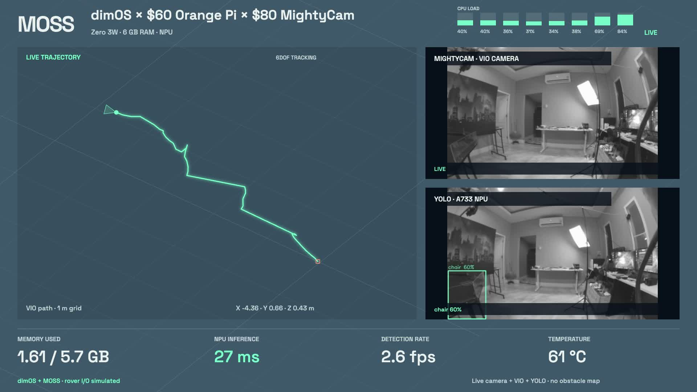

# dimOS × $60 Orange Pi × $80 MightyCam

Fresh hardware on the bench, and a question: how cheap can we make the brains and perception for **MOSS, the litter-picking rover**?

This is our first experiment with an **Orange Pi Zero 3W, 6 GB**, and a **MightyCam**, carried around the workshop on a power bank. We loaded MOSS/dimOS and ran YOLO on the Orange Pi's NPU. Whole-system memory use was around **1.6–1.7 GiB**.

**This is a load-test demo, not a working autonomous rover configuration.** No real motors or servos were driven. The trajectory drifted badly, calibration still needs investigating, and the detector recognizes everyday objects rather than litter.

*A frame from the first recording on 27 October 2026. The trajectory is the camera's reported path; it is not a validated map or distance measurement.*

## What we tested

- Real MightyCam images and pose messages over USB. **VIO runs in the camera**, and dimOS receives its output on the Orange Pi.
- YOLOv5 with ordinary COCO classes, running through the **A733 NPU / VIPLite** backend. This is not our litter detector.
- MOSS modules loaded together: base and arm controllers, LiDAR odometry, costmap, planner, exploration, recording and the mission module. LiDAR scans and actuator buses are simulated; the planner and mission are not completing a physical task.
- A browser cockpit with two camera views, the reported trajectory, eight CPU meters, RAM, NPU timing and temperature. **Record** saves a silent 1080p landscape video, up to 30 seconds. **Reset path** clears/rebases the displayed trace only.

## First measurements

| Measurement | Observed on this setup |
|---|---|
| Whole-system RAM, loaded bench | About 1.6–1.7 GiB used, out of 5.7 GiB usable |
| Swap during the checked samples | 0 |
| NPU network inference, YOLOv5 at 640 × 640 | About 26–30 ms |
| Complete detector pipeline | About 330–390 ms per image |
| Displayed detection throughput | About 2.6–2.8 images/s |

The NPU number is **only the network execution time**. Image handling, model setup, output conversion and drawing take additional time. RAM is Linux `MemTotal - MemAvailable`, including the operating system; it is not just one Python process. CPU meters use per-core `/proc/stat` deltas. See the [measurement snapshot](results/2026-10-27.json) for the conditions and stream counts.

The $60 and $80 figures are the component prices used for this experiment, not the price of a complete rover. The power bank, SD card and cooling kit are additional.

## What did not work

The first path looked plausible, but it failed to return to the starting point. Later, the camera reported much more travel than the real movement, and a restart produced wildly diverging coordinates. A `TRACKING` status did **not** establish accurate scale or position.

The camera's calibration request returned `calib.yaml not found`. That is an unresolved finding, not proof of the sole cause: initialization, camera/IMU calibration, synchronization and firmware still need checking. We have not calibrated this setup or validated navigation or pickup. See [Mighty's calibration guide](https://mightycamera.com/docs/calibration) and [pose-usability documentation](https://mightycamera.com/docs/sdk/pose).

The camera also once resumed images with VIO stopped after a stream interruption. The current adapter starts VIO at launch but does not automatically recover every stopped-tracking case. Resetting the drawn path cannot fix that or correct drift.

## Code and running it

Start with [SETUP.md](SETUP.md). Three profiles are included:

| Profile | Contents |
|---|---|
| `mighty` | Camera, VIO messages and cockpit |
| `demo` | Camera + NPU detector + cockpit |
| `full-bench` | The above plus MOSS modules with simulated rover I/O |

Only run one profile at a time: they share the dimOS coordinator and LCM bus. `full-bench` forces simulated motor/servo interfaces. It is intended for this tabletop experiment, not installation on a moving rover.

The Python package is in [`moss_mighty/`](moss_mighty/). The cockpit lives beside it. [`scripts/`](scripts/) contains the launcher and a pinned downloader/build helper for the upstream NPU example. [`tests/`](tests/) contains software checks; passing them does not validate camera accuracy.

Tested platform: Orange Pi **Zero 3W / Allwinner A733**, Armbian 26.8.1 / Debian 13, vendor kernel 6.6.98, Python 3.12. This is not the older H618 Orange Pi Zero 3. [Exact source revisions and credits](SOURCES.md).

Next: establish a reliable camera/IMU calibration, measure a known distance and a return-to-start path, then look at a litter-specific detector. For now, this gives us a first look at what fits on a small, inexpensive computer.
