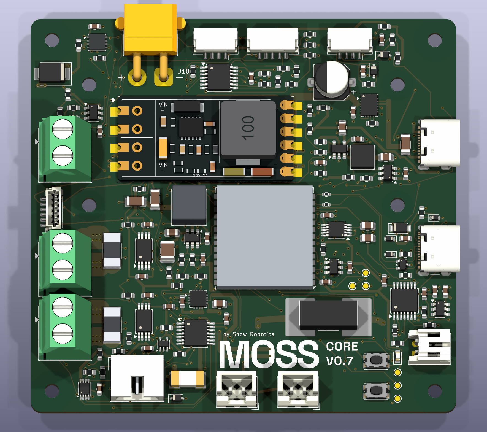
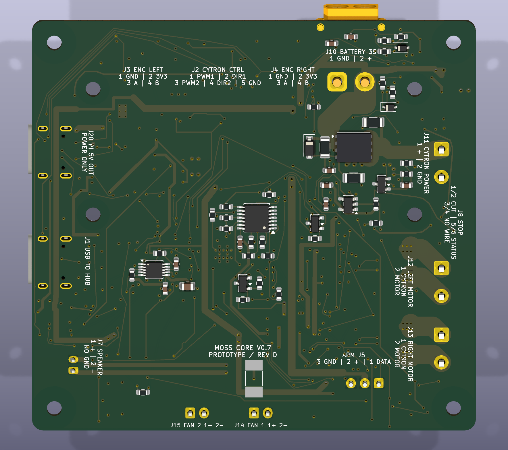

# MOSS CORE V0.7 — Prototype

This is my first custom PCB for **MOSS, the litter-picking rover**, designed with Codex and KiCad. I am publishing the editable design so people with electronics experience can help review it before the first assembled prototypes are tested.

**Not fabricated yet. Untested prototype, not a production-ready or hardware-qualified design.** Hardware revision letters will be assigned to fabricated boards; internal CAD snapshots are not hardware revisions. This folder is the single current public design reference.





## What the board does

The 80 × 75 mm, four-layer board combines an ESP32-S3 controller, a powered half-duplex serial-servo interface, Cytron control and encoder interfaces, left/right motor-current sensing, battery-voltage measurement, an I2S speaker amplifier and an Orange Pi power supply based on a soldered Waveshare module. The Cytron motor driver and USB hub remain external.

The arm uses one daisy-chain connector for the standard six-servo configuration, or seven with the optional twin shoulder. The selected connector and the actual common power harness still need aggregate-current qualification. Core firmware needs its own port and commissioning; this is not a drop-in replacement for the existing controller firmware.

The current design includes two chassis-fan outputs, corrected connector legends, the six-position stop connector with two deliberately unwired positions, and a compact soldered **Littelfuse 08853.15DR, 3.15 A**, on the Orange Pi supply input branch. F1 has no separate holder, cartridge or cover; replacement requires soldering. F2/F3 are separate 1 A audio/fan branch fuses, and the external 15 A pack fuse remains required.

The fan outputs carry fused 3S battery voltage, up to 12.6 V, rather than regulated 12 V. Their combined 0.2 A running current is an estimate, not a measurement. See the [connector guide](CONNECTORS.md) and [F1 selection evidence](evidence/F1_SELECTION.md).

## Harness packaging study

The separate [harness study](harness/) adds a 3D viewer, a short film, a photo-based HB1 model, the original R92 speaker and a hull prototype with integral cable-tie supports. It is an unbuilt packaging proposal; the board files below are unchanged.

## Download and inspect

- [Complete prototype review package](delivery/MOSS_CORE_V07_PROTOTYPE_REVIEW_20261030.zip).
- [KiCad project](electrical/MOSS_Core_V07_Prototype.kicad_pro), [PCB](electrical/MOSS_Core_V07_Prototype.kicad_pcb) and [root schematic](electrical/MOSS_Core_V07_Prototype.kicad_sch).
- [Physical-pin circuit contract](electrical/circuit.json), local symbols and footprints in `electrical/`.
- [Grouped component BOM](delivery/assembly/MOSS_CORE_V07_PROTOTYPE_BOM.csv) and [placement file](delivery/assembly/MOSS_CORE_V07_PROTOTYPE_POSITIONS.csv): 194 placed components, 89 purchase articles. The native board also contains mounting holes and test pads, for 208 footprints total.
- [Gerbers and drills](delivery/MOSS_CORE_V07_PROTOTYPE_GERBERS_20261030.zip), with [fabrication notes](delivery/fabrication/FABRICATION_NOTES.txt), exported from this exact board for engineering review.
- [File hashes](MANIFEST.json), [check results](evidence/CHECKS.json) and [publication provenance](evidence/PUBLICATION_NOTES.json).

Use KiCad 10. Open the project from `electrical/` so `${KIPRJMOD}` resolves its local libraries and models. All 44 model files referenced by the native PCB are included. Preserve the reviewed native-board model settings when updating footprints: some library defaults still reference KiCad's installed models. Several custom models are dimensioned visual approximations, not manufacturer mating CAD.

The published PCB bytes match the adopted prototype:

```text
SHA-256: cffb4a378502802a778fcee618310e6f3fa5c49ad201b0c372728368ae3520d1
```

## Community review welcome

The recorded [ERC](evidence/ERC.json) has zero violations. The [PCB DRC](evidence/DRC.json), under the saved project rules, has zero errors, zero missing connections and zero schematic-parity issues. Two pre-existing locked dangling-track warnings remain on `PWM_L` and `BAT_PROTECTED`. These checks do not establish that the powered board works safely or reliably.

I would especially welcome review of:

- Exact component/pin/footprint matching and connector mating/polarity.
- Power distribution, conductor sizing, return paths, decoupling and routing.
- Host-supply startup and voltage margin, fuse/conductor coordination, thermal behavior and realistic hub/peripheral loads.
- The shared servo connector/harness current, actuator-cutoff behavior and motor regeneration/BMS interactions.

These remain open design and bench-validation topics. The fan connector identity/current and stop-button contact arrangement also need physical confirmation. No firmware or real-load test result is implied by the views or static checks.

Please [open an issue](https://github.com/metrox-eth/moss/issues) with **MOSS CORE V0.7 Prototype**, the component/net reference, and the relevant datasheet or calculation. Corrections and practical suggestions are very welcome.

## Editing and re-export

Edit the native KiCad design in this folder. Update the circuit contract and assembly BOM when components change. `python3 tools/export_package.py` runs the native checks and regenerates the delivery files. It stops on errors, missing connections, parity differences or an unexpected assembly inventory. `--reuse-checks` requires every recorded design-file hash to match the successful checks. Review the results before manufacturing or powered tests.

## License and provenance

MOSS hardware design: [CERN-OHL-S-2.0](LICENSE-HARDWARE). Documentation/media: CC BY 4.0, as described in the repository [NOTICE](NOTICE). Bundled KiCad library material retains its [upstream license and exception](KiCad_Libraries_LICENSE.md).

Supplier correspondence, account/order information and unrelated workshop files are excluded. Local provenance paths in reports were converted to package-relative paths. The native PCB, schematic, footprints and matching fabrication/assembly data are preserved.
