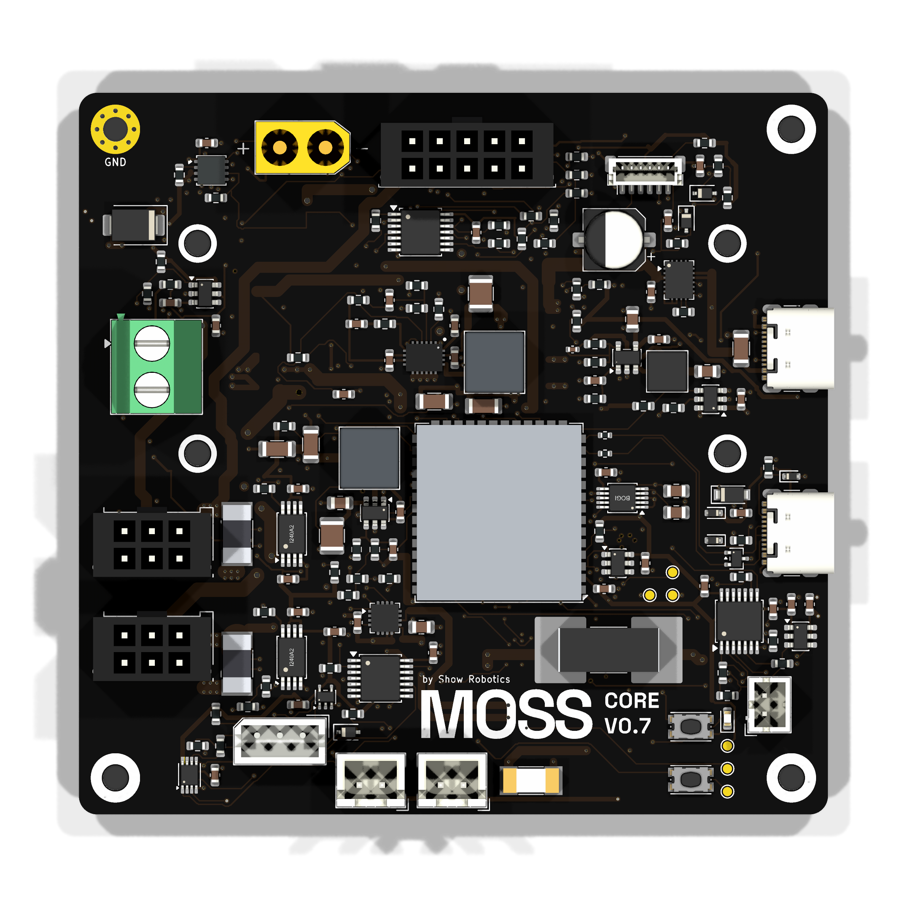
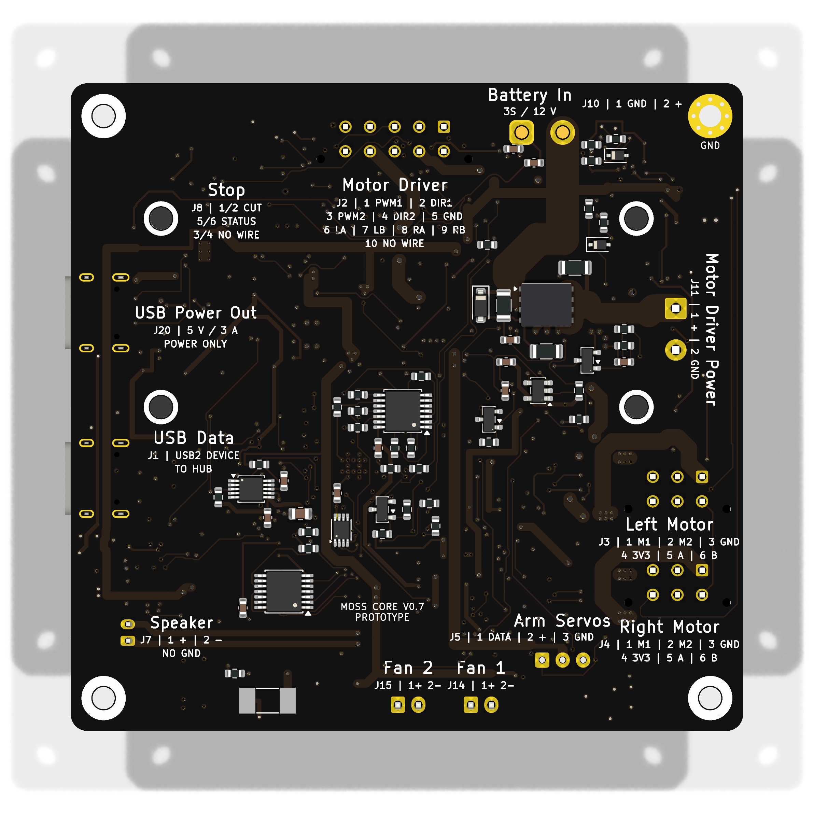

# MOSS CORE V0.7 — Prototype

This is my first custom PCB for **MOSS, the litter-picking rover**, designed with Codex and KiCad. I am publishing the editable design so people with electronics experience can help review it before the first assembled prototypes are tested.

**Updated 2 November 2026: component reference markings.** The matched files below describe the current layout for PCBWay engineering review. This is still the first, unbuilt prototype; hardware revision letters are reserved for fabricated boards.

## What changed

The current update adds printed component references while keeping the existing numbering. It changes the legends only: the circuit, components, copper, drill pattern, connector pinouts and placements remain the same as the power/rearm design. See [reference markings and verification scope](SILKSCREEN_UPDATE.md), including the U15 dense-area exception and its assembly locator.

The preceding electrical update is retained:

- **Supply recovery now requires a fresh arm pulse.** A hardware latch prevents held enable/PWM levels from automatically reopening the command gates after a qualified actuator-supply fault. GPIO1 provides the arm pulse; GPIO2 reads back the latch. The firmware must support this interface.
- **Logic-regulator transient response:** C170 adds the 6.8 pF feedforward capacitor recommended by TI for the existing feedback divider. The nominal logic voltage remains 3.384 V. Its response under load still needs measurement.
- **Targeted corner cleanup:** actual right-angle bends were chamfered on selected USB, audio, encoder and ADC paths. Track orientation and bend angle are now checked separately. Existing motor-power widths and shunt connections are preserved.

The 82 × 79 mm black board, 74 × 71 mm Core fixing pattern, Orange Pi mounting pattern, vertical connectors and harness pinout are retained. The updated hull already follows these fixing centres. This remains the first, unbuilt prototype, without a new physical revision letter.

See [power behavior, firmware rearming and bench checks](POWER_AND_REARM.md). The latch inhibits motor command signals and new servo UART transmission; it does not certify servo power-up behavior or EMI immunity.

The native design, assembly inventory and fabrication outputs below form one matched set for engineering review.





## What the board does

The four-layer board has an **82 × 79 mm rounded rectangular outline**, without protruding ears. The chassis mounting pattern is now 74 × 71 mm; Orange Pi standoff positions are unchanged. It combines an ESP32-S3 controller, a powered half-duplex serial-servo interface, Cytron control and encoder interfaces, left/right motor-current sensing, battery-voltage measurement, an I2S speaker amplifier and an integrated Orange Pi power supply. The Cytron motor driver and USB hub remain external.

The arm uses one daisy-chain connector for the standard six-servo configuration, or seven with the optional twin shoulder. The selected connector and the actual common power harness still need aggregate-current qualification. Core firmware needs its own port and commissioning; this is not a drop-in replacement for the existing controller firmware.

The current design includes two chassis-fan outputs, corrected connector legends, the six-position stop connector with two deliberately unwired positions, and a compact soldered **Littelfuse 08853.15DR, 3.15 A**, on the Orange Pi supply input branch. F1 has no separate holder, cartridge or cover; replacement requires soldering. F2/F3 are separate 1 A audio/fan branch fuses, and the external 15 A pack fuse remains required.

The fan outputs carry fused 3S battery voltage, up to 12.6 V, rather than regulated 12 V. Their combined 0.2 A running current is an estimate, not a measurement. See the [connector guide](CONNECTORS.md) and [F1 selection evidence](evidence/F1_SELECTION.md).

## Orange Pi assembly clearance

The combined [mechanical review](evidence/MECHANICAL_REVIEW.json) uses **20 mm Orange Pi standoffs**, a CAD mounting height, and the measured **16 mm total Orange Pi/cooler height**. The [updated hull prototype](https://github.com/metrox-eth/moss/tree/main/hardware/mechanical/moss-v0.7-hull) uses the new **74 × 71 mm Core fixing pattern**, with its own geometry checks and editable source. The earlier mechanical review remains evidence for the upper stack; its request to update the hull posts is addressed by this separate hull update. The component bodies clear the Orange Pi and four standoffs, including a 6 mm diameter standoff reservation. The conservative vertical gap from the highest component beneath the Orange Pi to its lowest underside feature is **4.15 mm**.

The mated-connector and wire checks use supplier dimensions where available and declared clearance envelopes elsewhere. **Route J2's wires rearward and J3's wires leftward, away from the Orange Pi, before bringing them upward.** A straight, expanded vertical bundle reservation at these two ports intersects the Orange Pi CAD. This is an assembly routing condition; the exact cable and connector tolerances still need checking on the first prototype. The cooler's lateral shape was not supplied, so its final cable clearance also needs checking.

The [outward cable-route check](preview/CABLE_CLEARANCE_ROUTES.png) uses declared 5 mm bundles with 10 mm bend radii. These example routes clear the supplied Pi, standoffs and hull CAD, plus the conservative cooler envelope; they are clearance reservations, not manufacturing drawings for a finished harness. [Intersection results](evidence/CABLE_CLEARANCE_ROUTES.json).

The [mounting table](MOUNTING.md) gives the current chassis fixing pattern. The [update equivalence report](evidence/UPDATE_EQUIVALENCE.json) identifies the preserved geometry and prior evidence that remains applicable. The [730-pin consistency check](evidence/DESIGN_CONTRACT.json), [routing-angle check](evidence/TRACK_ANGLES.json) and [rearm state-model results](evidence/LOGIC_REARM_MODEL.json) cover the updated files. These are static and modeled checks, not powered or thermal test results.

## Harness packaging study

The [harness study](https://github.com/metrox-eth/moss/tree/main/hardware/electronics/moss-core-v0.7/harness) follows the current integrated-power board and vertical connectors. Each motor uses one six-wire cable to J3/J4. A nine-wire link at J2 groups the Cytron control and motor-output circuits; J11 retains its separate supply. The model includes the updated hull fixings, five cable-tie bridges and the divider notch. The package contains current CAD, an offline viewer, wiring schedules and a prototype RFQ. The harness model retains the earlier board body; connector geometry and pin assignments are unchanged by this update. The latest internal-component views are the two images above. The older film is historical and is not evidence for this layout. Physical fit and electrical operation remain first-prototype checks.

## Assembly review

A [focused mask/paste and BOM review](evidence/assembly_review/README.md) checked the current-sense shunts and amplifiers. Their apertures remain separate; the later legend update preserves these openings and the production CSV. A classified BOM view makes semiconductors, passives and connectors easier to inspect. Stencil and reflow-process confirmation remains with PCBWay.

## Firmware and commissioning

The separate [Core V0.7 commissioning firmware](https://github.com/metrox-eth/moss/tree/main/firmware/core-v0.7) reuses the current MDD10A ramp and encoder code. It implements the new rearm interface, USB commands/telemetry, battery and motor-current readings, half-duplex Feetech communication including group writes, and an I²S speaker test. The existing V0.6 controller remains the tested rover target.

The ESP32-S3 build passes with zero compiler warnings. Shared-code host tests and a separate review cover faults, stale commands, timing, measurements and serial behavior. [Evidence and source hashes](evidence/FIRMWARE_CROSSCHECK.json). No firmware has been flashed to this new board, and no powered operation or EMI result is claimed. Its commissioning console is explicit; this is not yet a drop-in dimOS controller/arm adapter.

## Download and inspect

- [Complete prototype review package](delivery/MOSS_CORE_V07_PROTOTYPE_REVIEW_20261102_SILKSCREEN.zip).
- [KiCad project](electrical/MOSS_Core_V07_Prototype.kicad_pro), [PCB](electrical/MOSS_Core_V07_Prototype.kicad_pcb) and [root schematic](electrical/MOSS_Core_V07_Prototype.kicad_sch).
- [Physical-pin circuit contract](electrical/circuit.json), local symbols and footprints in `electrical/`.
- [Grouped component BOM](delivery/assembly/MOSS_CORE_V07_PROTOTYPE_BOM.csv) and [placement file](delivery/assembly/MOSS_CORE_V07_PROTOTYPE_POSITIONS.csv): **216 placed components, 99 purchase articles**. The native board also contains mounting holes and test pads, for 230 footprints total.
- [Gerbers and drills](delivery/MOSS_CORE_V07_PROTOTYPE_GERBERS_20261102_SILKSCREEN.zip), with [fabrication notes](delivery/fabrication/FABRICATION_NOTES.txt) and [assembly notes](delivery/assembly/ASSEMBLY_NOTES.txt).
- [File hashes](MANIFEST.json), [check results](evidence/CHECKS.json) and [publication provenance](evidence/PUBLICATION_NOTES.json).

Use KiCad 10. Open the project from `electrical/` so `${KIPRJMOD}` resolves its local libraries and models. Preserve the native-board model settings when updating footprints: some library defaults reference KiCad's installed models. Several custom models are visual approximations, not manufacturer mating CAD. The previews add a simple U60 body and manufacturer-based IC markings, with the ESP shield left unmarked, documented in [visual provenance](preview/VISUAL_PROVENANCE.json); the native PCB is unchanged.

The native candidate PCB is identified by:

```text
SHA-256: 4f456f0563e9dc5a3b7cbab98eaa8d9f24485d14dc79a7656af5ab04b983b6b1
```

## Community review welcome

**Not fabricated or hardware-qualified yet.** The recorded [ERC](evidence/ERC.json) has zero violations. The [PCB DRC](evidence/DRC.json), under the saved project rules, has zero errors, zero missing connections and zero schematic-parity issues. Two bounded warnings are documented in the check report: a retained free copper tip on the battery branch, and a tiny C21 silkscreen clip. The latter is removed from the production ink by the explicit solder-mask subtraction during Gerber export; it does not change copper or drills. These are static checks, not powered test results.

I would especially welcome review of:

- Exact component/pin/footprint matching and connector mating/polarity.
- Power distribution, conductor sizing, return paths, decoupling and routing.
- Integrated-converter startup, ripple and stability with the existing output capacitance, load transients, fuse coordination and thermal behavior.
- The shared servo connector/harness current, actuator-cutoff behavior and motor regeneration/BMS interactions.

The new motor paths use the supplier data for the 90:1 / 110 rpm motors (up to 1 A rated and 2.3 A stall at 12 V), rather than the Cytron's 10 A channel headline. This quotation requests 1 oz copper on all four layers. Load/thermal tests and fault-protection coordination remain necessary; a clean DRC does not establish those ratings.

These remain open design and bench-validation topics. The fan connector identity/current and stop-button contact arrangement also need physical confirmation. No firmware or real-load test result is implied by the views or static checks.

Please [open an issue](https://github.com/metrox-eth/moss/issues) with **MOSS CORE V0.7 Prototype**, the component/net reference, and the relevant datasheet or calculation. Corrections and practical suggestions are very welcome.

## Editing and re-export

Edit the native KiCad design in this folder. Run `python3 tools/check_rearm_logic.py --design . --output evidence/LOGIC_REARM_MODEL.json` after regenerating the netlist to check the rearm state model. Update the circuit contract and assembly BOM when components change. `python3 tools/export_package.py` runs the native checks and regenerates the delivery files. It stops on errors, missing connections, parity differences or an unexpected assembly inventory. `--reuse-checks` requires every recorded design-file hash to match the successful checks. Review the results before manufacturing or powered tests.

## License and provenance

From **1 November 2026**, the current distribution of MOSS-authored hardware design files is offered under **[CC BY-NC-SA 4.0](LICENSE-HARDWARE)**: attribution, noncommercial use and ShareAlike. This covers the PCB design, fabrication outputs and MOSS-authored wiring/harness designs.

Code remains under Apache-2.0; documentation and media remain under CC BY 4.0. Bundled KiCad library collections retain their [CC BY-SA 4.0 licence and KiCad Libraries Exception](KiCad_Libraries_LICENSE.md), and other third-party material keeps its own terms. See [NOTICE](NOTICE).

Earlier copies and releases distributed under CERN-OHL-S-2.0 retain their original grants. This notice does not withdraw or retroactively replace those rights.

Supplier correspondence, account/order information and unrelated workshop files are excluded. Local provenance paths in reports were converted to package-relative paths. File hashes identify each submitted design and its matching fabrication/assembly data. Earlier checks retain their original hashes and are identified as baseline evidence where applicable.
