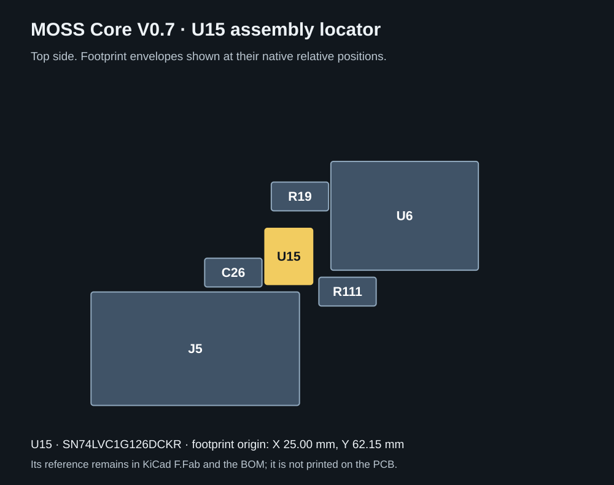

# Component reference markings

Updated 2 November 2026 for the first MOSS Core V0.7 prototype.

Following feedback from [@racenerd2](https://x.com/racenerd2), printed component references make it easier to locate a part while comparing the assembled board with the schematic and BOM. The existing reference numbers are retained. There is no geographical renumbering and no new physical revision letter.

The added white legend uses at least 0.8 mm character height and 0.15 mm strokes, with 0.15 mm clearance from solder-mask openings. These follow [PCBWay's text guidance](https://www.pcbway.com/helpcenter/design_instruction/How_to_make_my_silkscreen_clear_and_beautiful_on_PCB__.html) and [opening-clearance guidance](https://www.pcbway.com/helpcenter/Engineering_Questions/Spacing_between_silkscreen_and_openings.html). Functional connector labels and polarity markings are retained. Fabrication-layer reference copies remain available in KiCad.

## Coverage and the dense-area exception

214 of the 216 assembled components have newly printed native reference labels. J1 remains identified by its existing rear USB Data / J1 legend. U15 is the only assembled component without a printed reference: the available front-side gaps do not fit the 0.8 mm / 0.15 mm lettering with the required clearances. Its reference remains in F.Fab, the schematic and the BOM.

**Find U15:** the small five-pin SN74LVC1G126DCKR below R19, left of U6, above J5 and beside C26/R111. Its footprint origin is X 25.00 mm, Y 62.15 mm in the native PCB. The diagram below uses the unchanged native footprint envelopes.

J3 and J4 have vertical labels in the left board margin, outside the connector bodies. Their clearance was checked against the actual Micro-Fit STEP envelope. Four short printed leaders identify R35, R56, D2 and R105 where adjacent placement would be ambiguous. These leaders are legend ink, not copper traces.

## Verification scope

The silkscreen change must preserve all electrical identities, component positions, pads, copper, vias, stored plane geometry, drills, models and board outline. The [independent native comparison](evidence/SILK_ONLY_EQUIVALENCE.json) records those invariants. Schematic, circuit contract, production BOM CSV and placement CSV stay byte-identical. Only explanatory notes in the BOM JSON change to name this matched package; all inventory data remains identical.

The final native DRC and the reference-to-opening geometry check cover the new printed legends. Flat top and bottom renders are inspected for readability and association with the correct component. A clean DRC alone does not prove readable lettering.

Earlier power, logic, firmware and mechanical evidence keeps its original input hashes. An explicit equivalence record links it to the new PCB presentation; it does not claim a new electrical simulation or powered hardware test.

This remains an unbuilt prototype. Actual print quality, assembly, electrical behavior and operation under load still require the first physical boards.
