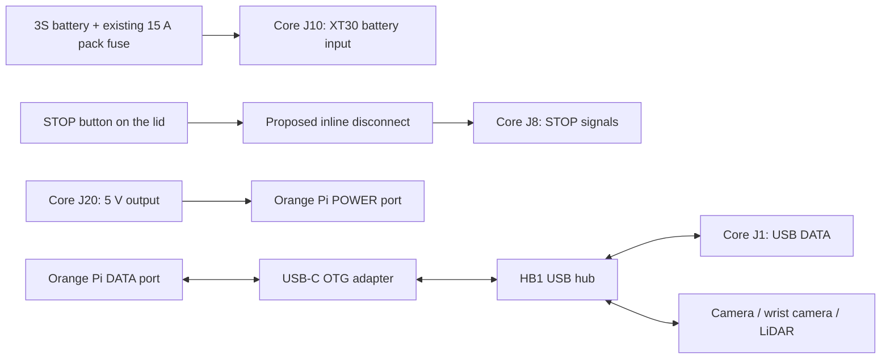

# Where the cables go

**STOP is J8. Battery is XT30 J10. USB is separate.** Crossing or sharing a routing corridor does not mean two cables are electrically connected.

The diagram describes the intended connections. Peripheral USB cables are not all drawn in the 3D packaging scene, and USB power/bandwidth performance is not validated by this model.

| Core connector | Connection | Important distinction |
| --- | --- | --- |
| J8 | STOP button, through the lid disconnect | Six-position JST SH housing with **four** contacts: 1, 2, 5 and 6. Positions 3 and 4 have no contact or wire. Low-current circuits only. |
| J10 | Battery XT30 lead | Separate power feed. The existing external 15 A pack fuse remains required. |
| J20 | Orange Pi **POWER** USB-C port | Power-only output. Not a hub data port. |
| J1 | One HB1 downstream port | USB data connection to the Core controller. |
| J11 | Cytron power input | Cytron remains a separate motor driver. |
| J2 | Cytron control header | Five control/reference wires. |
| J3 / J4 | Left / right encoder wiring | Four wires join the corresponding motor's six-way plug. |
| J12 / J13 | Left / right motor-current measurement path | One motor leg runs through the corresponding measurement path; the other comes directly from the Cytron. Both reach the same motor plug. |
| J5 | Arm servo chain | One three-wire bus connector, not six separate servo sockets. |
| J7 | Speaker lead | Two amplifier outputs; neither is a ground return. |
| J14 / J15 | Chassis fans | Fused 3S battery rail, not regulated 12 V. |

## STOP contact arrangement

The current Core circuit contract expects two independent normally closed contacts:

- J8.1 / J8.2: CUT source and return.
- J8.5 / J8.6: STATUS source and return.
- J8.3 / J8.4: deliberately unconnected.

For a newly supplied kit, specify **YJ-LA16-22ZS/A**, non-illuminated: C1-NC1 for CUT and C2-NC2 for STATUS. The existing unmarked button needs a continuity check to identify these pairs. The older LA16-11ZS/A BOM entry does not specify the two independent contacts required here.

The lid disconnect is **Molex PicoBlade 51021-0400 / 51047-0400**, female contacts **50058-8000**, male contacts **50133-8000**. Use **28 AWG, insulation OD 0.50-0.80 mm** throughout H08. Map J8.1/2/5/6 to inline circuits 1/2/3/4 respectively, by the manufacturer's cavity numbers. The connector is friction-retained; disconnect by its housings.

## Motor plugs

Use the six-wire pigtails included with **Arduitronics RU00129**, JGB37-520, 12 V / 110 rpm. The product photos show M1/M2, VCC/GND and C1/C2 on the encoder board. Preserve the motor-end plugs and trace the supplied wires to those labels before terminating the first kit; record the result for both motors.

Core encoder pin order is **1 GND, 2 switched 3.3 V, 3 A, 4 B**. Motor power goes to M1/M2, separately from encoder VCC/GND. Heavy power legs require a factory transition to the stock pigtails; do not force 16 AWG into the small motor contacts. The animation's colours are illustrative, not a crimp drawing.

Manufacturer references and the reason for retaining the stock motor plugs are in [interface verification](INTERFACE_VERIFICATION.md).

## Hub cable

The model follows the official **USB-A HB1** product: four top USB-A ports and an 80 cm captive USB-A lead. A short USB-C OTG adapter is illustrated at the Orange Pi DATA connection. Only the routed portion of the captive lead is shown; the remaining cable storage, actual adapter dimensions and final bend radii are unresolved packaging details.

Electrical reference: the current [Core connector guide](../CONNECTORS.md) and [physical-pin circuit contract](../electrical/circuit.json). This harness study does not modify either one.
