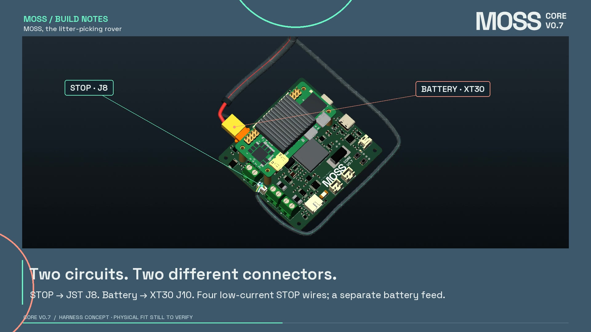
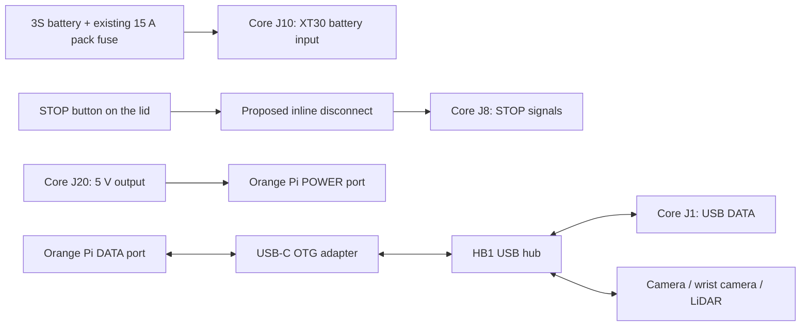
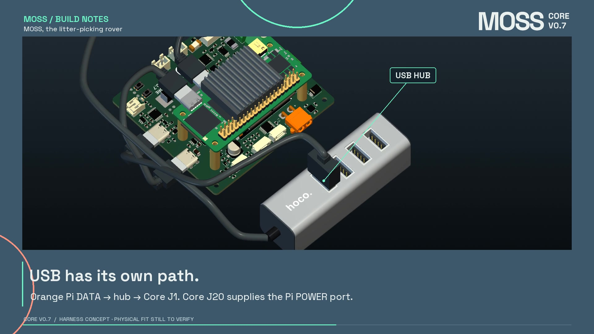

# Where the cables go

**STOP is J8. Battery is XT30 J10. USB is separate.** Crossing or sharing a routing corridor does not mean two cables are electrically connected.

The diagram describes the intended connections. Peripheral USB cables are not all drawn in the 3D packaging scene, and USB power/bandwidth performance is not validated by this model.

| Core connector | Connection | Important distinction |
| --- | --- | --- |
| J8 | STOP button, through the lid disconnect | Six-position JST SH housing with **four** contacts: 1, 2, 5 and 6. Positions 3 and 4 have no contact or wire. Low-current circuits only. |
| J10 | Battery XT30 lead | Separate power feed. The existing external 15 A pack fuse remains required. |
| J20 | Orange Pi **POWER** USB-C port | Power-only output. Not a hub data port. |
| J1 | One HB1 downstream port | USB data connection to the Core controller. |
| J11 | Cytron power input | Cytron remains a separate motor driver. |
| J2 | Cytron control header | Five control/reference wires. |
| J3 / J4 | Left / right encoder wiring | Four wires join the corresponding motor's six-way plug. |
| J12 / J13 | Left / right motor-current measurement path | One motor leg runs through the corresponding measurement path; the other comes directly from the Cytron. Both reach the same motor plug. |
| J5 | Arm servo chain | One three-wire bus connector, not six separate servo sockets. |
| J7 | Speaker lead | Two amplifier outputs; neither is a ground return. |
| J14 / J15 | Chassis fans | Fused 3S battery rail, not regulated 12 V. |

## STOP contact arrangement

The current Core circuit contract expects two independent normally closed contacts:

- J8.1 / J8.2: CUT source and return.
- J8.5 / J8.6: STATUS source and return.
- J8.3 / J8.4: deliberately unconnected.

The six terminals of the physical pushbutton have **not** been identified from a datasheet or continuity measurement. The NC/common terminal mapping must be checked before wiring. The drawing is not permission to assume a terminal order from appearance.

The four-way Micro-Fit-style inline body is a **candidate** for disconnecting the lid. Its contact/wire-insulation compatibility still needs resolution; it is not a frozen purchase or crimp specification.

## Motor plugs

The current motors have the same white six-wire connector as the workshop reference photographs, confirmed by the owner. The visual model uses an XH-style 2.5 mm arrangement with a 17.3 mm-wide cable housing. Exact vendor identity, motor pin order and connector clocking still require confirmation. **Do not wire a motor from the colour order shown in the animation.**

The heavier external motor-power legs transition to the existing thin motor pigtails in the model. A fabricator must confirm the actual wire gauges and transition method; a heavy power wire must not simply be forced into an incompatible small terminal.

## Hub cable

The model follows the official **USB-A HB1** product: four top USB-A ports and an 80 cm captive USB-A lead. A short USB-C OTG adapter is illustrated at the Orange Pi DATA connection. Only the routed portion of the captive lead is shown; the remaining cable storage, actual adapter dimensions and final bend radii are unresolved packaging details.

Electrical reference: the current [Core connector guide](../CONNECTORS.md) and [physical-pin circuit contract](../electrical/circuit.json). This harness study does not modify either one.
