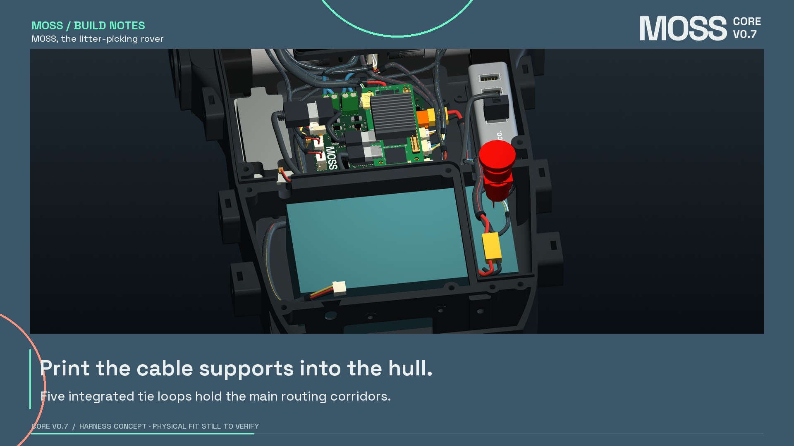

# MOSS CORE V0.7 - Harness study

A removable wiring loom for **MOSS, the litter-picking rover**, connecting the Core board, Cytron motor driver, two encoder motors and lid-mounted STOP button. Five cable-tie bridges and a divider notch are integrated into a prototype hull.

**Design study for prototype quotation.** Physical fit has not yet been tested. The released rover remains V0.6/R92.

## Explore

- [Studio film](media/MOSS_Harness_Story.mp4)
- [Offline 3D viewer](viewer/MOSS_HARNESS_VIEWER.zip) - unzip and open the HTML in a desktop browser with WebGL.
- [Wiring and connector guide](CONNECTIONS.md)
- [Interface verification](INTERFACE_VERIFICATION.md) - supplier references, corrections and remaining physical checks.
- [Prototype quotation package](rfq/MOSS_CORE_V07_HARNESS_RFQ.pdf)

## Layout

| Assembly | Connection |
| --- | --- |
| Battery | XT30 J10; retain the pack's existing fuse. |
| Cytron | J11 supply, J2 control and J12/J13 motor-current paths. |
| Motors | One six-wire plug per motor: two motor leads and four encoder wires. Retain the supplied Arduitronics motor pigtails. |
| Removable lid | J8, four signal wires through a small inline connector near the STOP button. |
| Orange Pi | J20 supplies its POWER port; DATA connects to the HB1 USB hub. |
| Other devices | Arm bus J5, speaker J7, fans J14/J15; cameras and LiDAR use the hub. |

## CAD and dimensions

| Download | Contents |
| --- | --- |
| [Routing STEP](cad/MOSS_HARNESS_ROUTING.step) / [centrelines](cad/MOSS_HARNESS_CENTRELINES.step) | 20 named routes in the R92 coordinate frame, in millimetres. |
| [Hull STEP](cad/Hull_MOSS_V07_Harness_Tie_Loops_PROTOTYPE.step) / [STL](cad/Hull_MOSS_V07_Harness_Tie_Loops_PROTOTYPE.stl) | Five integral tie bridges and a rounded divider notch. |
| [Tie-loop test coupon](cad/tie_anchor_fit_coupon.stl) | Test print for a 2.5 mm cable tie. |
| [HB1 STEP](cad/HOCO_HB1_Visual_Reference.step) / [speaker STEP](cad/Speaker_3W_4Ohm_R92_original.step) | Photo-based hub and original R92 speaker reference geometry. |

[Route data](data/ROUTE_LENGTHS.json) gives geometric cable paths. The quotation schedule adds a stated prototype allowance; it does not replace a fitted first-article check or the manufacturer's cut/strip schedule.

Generated wire endpoints, STEP reimport and sampled route clearances are checked in [evidence](evidence/). These checks cover the model, not physical connector mating. See [geometry sources](MODEL_PROVENANCE.md), [rebuild instructions](source/README.md) and [attribution](ATTRIBUTION.md).
