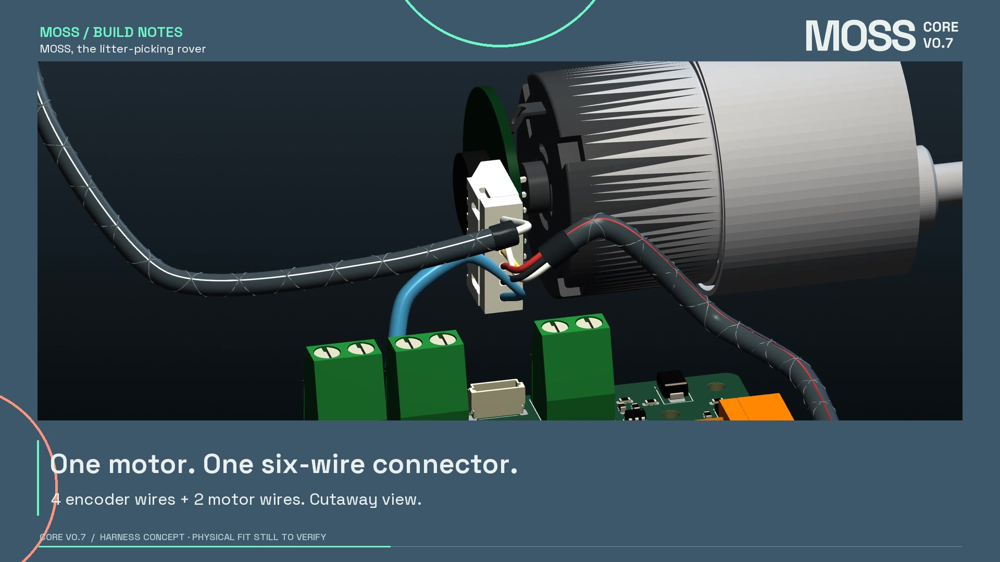

# MOSS CORE V0.7 — Harness study

I want **MOSS, the litter-picking rover**, to be easier to assemble and maintain. This is a cable-harness packaging study built with Codex around the current Core PCB, an Orange Pi Zero 3W and the existing rover hardware.

**CAD prototype, not a manufacturing release.** The existing MOSS build remains the released V0.6/R92 configuration. This study does not change the Core PCB or introduce a fabricated hardware revision. Connector suppliers, the motor pin order, cable cut lengths and fit on the physical rover still need confirmation.

## Watch and explore

- [42-second studio film](media/MOSS_Harness_Story.mp4): connections, sleeving, integrated hull supports, close-ups and the removable lid.
- [Download the offline 3D viewer](viewer/MOSS_HARNESS_VIEWER.zip). Unzip it and open `MOSS_HARNESS_VIEWER.html` in a browser with WebGL. It embeds the geometry and needs no account or server. The HTML is about 58 MB uncompressed; a desktop browser is recommended.
- [Connection guide](CONNECTIONS.md), including the separate STOP, battery and USB paths.
- [Geometry provenance and remaining fit questions](MODEL_PROVENANCE.md).

## What changed in this study

- Each motor has **one six-way connector** carrying four encoder wires and two motor wires. The owner confirmed that the current motors use the same white plug visible in the workshop photos. The XH-style visual match is not a confirmed manufacturer part number.
- Core-side mating housings use dimensions from public JST/Molex drawings. Wires end at their housing cavities, not at loose points beside the board.
- The **Hoco HB1** is reconstructed from official photographs and its published 78 × 25 × 25 mm envelope. Its four top-facing USB sockets are oriented across the body, and its captive USB-A lead connects through an illustrative USB-C OTG adapter.
- The **speaker is the original R92 CAD**, extracted without redrawing it and re-tessellated for the viewer.
- The battery XT30 pair is placed away from the STOP button. The STOP loom starts at **J8**, through a proposed disconnect near the lid; it does not carry battery current.
- Five cable-tie bridges are integrated into a **separate hull prototype**, together with a rounded wire notch in the battery divider. The bridges appear with the hull, not as floating harness parts.

## Editable CAD

| File | Contents |
| --- | --- |
| [Harness routing STEP](cad/MOSS_HARNESS_ROUTING.step) | 20 named outer route envelopes. These are routing reservations, not literal insulation or braid. |
| [Harness centrelines STEP](cad/MOSS_HARNESS_CENTRELINES.step) | Editable cubic curves corresponding to the visual routing. |
| [Hull prototype STEP](cad/Hull_MOSS_V07_Harness_Tie_Loops_PROTOTYPE.step) / [STL](cad/Hull_MOSS_V07_Harness_Tie_Loops_PROTOTYPE.stl) | Five integral tie bridges and the divider notch. Requires a physical fit check. |
| [Tie-loop test coupon](cad/tie_anchor_fit_coupon.stl) / [STEP](cad/tie_anchor_fit_coupon.step) | Small print to try a 2.5 mm cable tie before printing the hull. |
| [HB1 visual reference STEP](cad/HOCO_HB1_Visual_Reference.step) | Photo-based model, not manufacturer CAD. |
| [Original speaker STEP](cad/Speaker_3W_4Ohm_R92_original.step) | Existing R92 reference geometry, not a printable replacement speaker. |

The tie bridges have a 10 × 6 mm footprint, a 4 × 2.4 mm opening and a 1.8 mm roof. The divider notch is 14 mm wide, up to 9.5 mm deep, with R2 lower corners. Coordinate units are millimetres, in the native R92 frame.

[Route data](data/ROUTE_LENGTHS.json) records centreline and individual visual-conductor lengths. **These are not wire cut lengths.** Contact engagement, stripping, production tolerances, the final sleeves and real service slack have not been added as a qualified cut schedule.

## What has been checked

- The fixed board geometry corresponds to the current prototype PCB hash `cffb4a378502802a778fcee618310e6f3fa5c49ad201b0c372728368ae3520d1`.
- [Mesh endpoint checks](evidence/CONNECTION_CHECKS.json) verify the generated wires reach the declared Core and motor housing cavities and that the four coloured STOP paths align across the inline pair.
- [STEP checks](evidence/HARNESS_STEP_QA.json) reimport the 20 swept solids and preserve the 20 route names. Centrelines use the same cubic curves as the visual model.
- The [hull checks](evidence/hull_tie_variant_QA.json) and [notch checks](evidence/DIVIDER_WIRE_NOTCH_QA.json) cover the local attachment geometry and the watertight prototype print mesh.
- The [sparse route screen](evidence/ROUTING_CLEARANCE_SCREEN.json) found no flagged mid-route surface intersections in its stated scope. It excludes the first/last 12 mm, wire-to-wire collisions and connector-body mating. It is **not** a full collision or bending-radius qualification.

The unplugged-lid animation is an exploded illustration. It is not a simulated cable-flex or connector-release test.

## Manufacturing enquiry

PCBWay lists **Cable Wire Harness Assembly** among its [assembly services](https://www.pcbway.com/pcb-assembly.html). I am preparing an enquiry to see whether they can make a small MOSS cable kit. No acceptance, price or harness sponsorship is implied by this study. The proposed harness has not been ordered.

## Rebuild the visuals

The source and frozen geometry snapshots are included. See [source/README.md](source/README.md). The scene builder regenerates the mesh, route data and offline viewer. The supplied hull STEP/STL are editable design inputs; the scene builder does not regenerate their complete native design history.

MOSS additions follow the repository hardware/code/documentation licenses. Vendor marks, KiCad library geometry, Three.js and the font retain their own terms; see [ATTRIBUTION.md](ATTRIBUTION.md). No supplier correspondence, private order details or vendor-gated CAD downloads are included.
