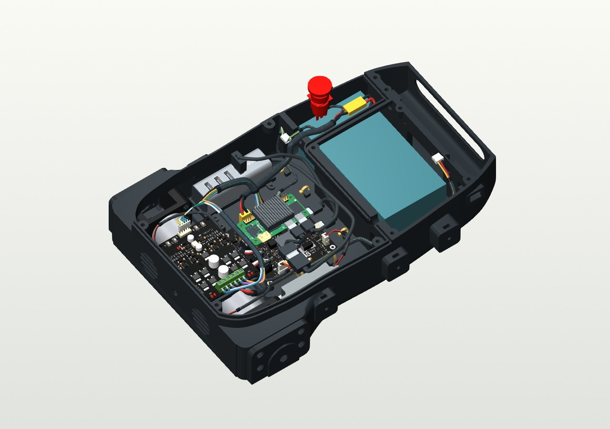

# MOSS Core V0.7 - wiring harness

Updated **1 November 2026** for the current 82 x 79 mm Core PCB and the matching hull with a 74 x 71 mm mounting pattern. This is a prototype cable kit for **MOSS, the litter-picking rover**; the released rover remains V0.6/R92.

The [power/rearm update compatibility note](COMPATIBILITY.md) explains why this harness still fits the updated Core PCB and distinguishes the retained viewer model from the latest internal electronics.

- **One six-wire cable per motor:** two winding leads and four encoder wires, through J3/J4 Micro-Fit connectors.
- **Cytron link:** J2 carries four control signals, signal GND and four winding outputs. J11 remains the separate supply. These form one loom assembly with two Core terminations; J2 cavity 10 is empty.
- **Detachable STOP tail:** two separate NC loops through J8 and a four-way inline disconnect near the lid button.
- **Current Core:** integrated 5 V converter, vertical battery/arm/speaker headers, two fan connectors and no external power module or fuse holder.

## Inspect and build

- [Offline 3D viewer](viewer/MOSS_HARNESS_VIEWER.zip) - unzip and open the HTML in a desktop browser with WebGL.
- [Current top view](media/CURRENT_TOP.png), [Core without Orange Pi](media/CURRENT_NO_PI.png), [Core with Orange Pi](media/CURRENT_CONNECTORS.png).
- [Connection guide](CONNECTIONS.md) and [interface/first-article checks](INTERFACE_VERIFICATION.md).
- [Prototype quotation PDF](rfq/MOSS_CORE_V07_HARNESS_RFQ.pdf), [42-wire schedule](rfq/WIRELIST.csv) and [machine-readable specification](rfq/HARNESS_SPECIFICATION.json).
- [Routing STEP](cad/MOSS_HARNESS_ROUTING.step), [common-trunk centrelines](cad/MOSS_HARNESS_CENTRELINES.step) and [route data](data/ROUTE_LENGTHS.json).
- [Hull STEP](cad/Hull_MOSS_V07_Harness_Tie_Loops_PROTOTYPE.step) / [STL](cad/Hull_MOSS_V07_Harness_Tie_Loops_PROTOTYPE.stl), with five integral cable-tie bridges and the divider notch. [Hull rebuild sources and editable Fusion file](../../../mechanical/moss-v0.7-hull/).

The model contains **14 routes and 42 custom wire segments**, plus three commercial USB cable assemblies. H03's STEP centreline covers its common trunk; its individual Cytron fanout paths and four-output sleeve are in the viewer and route data. [CAD notes](README_CAD.md) explain the length allowances and connector choices.

## What is checked

Native PCB/schematic/contract comparison covers [76 pins on 12 connectors](evidence/INDEPENDENT_CONNECTOR_MAP_20261101.json). [38 custom-wire starts](evidence/CONNECTION_CHECKS.json) match the Core cavity positions; the four remaining custom wires begin at the lid disconnect. All 14 common-trunk STEP sweeps reimport as valid solids.

Six full-diameter sleeve envelopes were checked against all 123 solids of the supplied Orange Pi CAD, including GPIO pins, and all four 20 mm standoffs: **zero intersection**, without trimming either end. The closest nominal Pi clearance is **1.77 mm** at J2's H03 trunk. See the [full CAD check](evidence/FULL_SLEEVE_OPI_QA.json), the separate [sampled route/context screen](evidence/CURRENT_ROUTE_CLEARANCE.json), and the [closed-cover/cooler screen](evidence/COOLER_LID_CLEARANCE.json). The latter includes all 42 complete wire paths and modeled sleeves, without endpoint exclusions: no contact with the closed cover or illustrative cooler. The real cooler shape was not supplied. H03 command loops stay below the Cytron cover roof; neither Cytron nor the cover was moved. The unchanged H03 trunk has 0.53 mm nominal clearance at the cover rib; physical wire/sleeve tolerances require first-article fitting. These are model checks, not physical-fit or electrical qualification.

Retain the supplied motor pigtails and record their cavity/function map by continuity on the first article. Physical connector seating, wire/sleeve tolerances, closed-lid fit, strain relief, motor noise immunity and storage of the hub's 800 mm captive USB lead still require a fitted prototype. The old film shows the superseded 30 October layout and is not a current assembly reference. The offline bundle and static views were checked; browser interaction was not tested.

See [geometry provenance](MODEL_PROVENANCE.md), [rebuild instructions](source/README.md) and [attribution/licensing](ATTRIBUTION.md). No PCB fabrication or assembly source is changed by this harness study.
