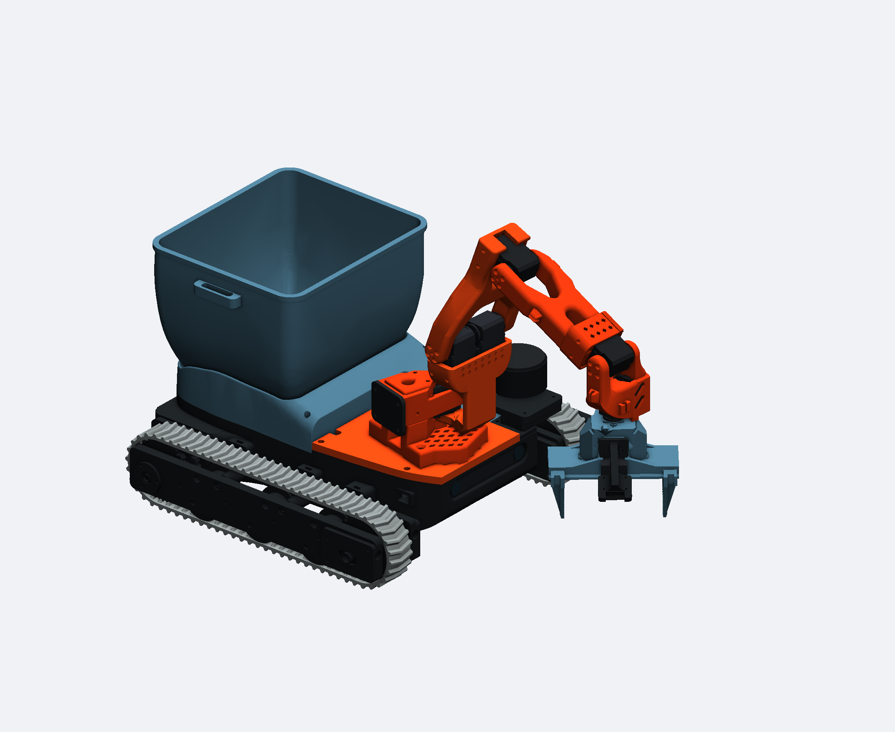
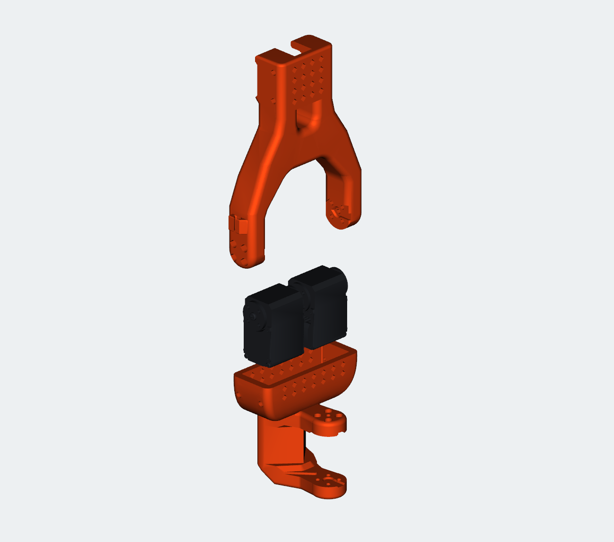

# MOSS — SO-101 dual-servo shoulder, R2

Two shoulder servos sit back to back in one printed housing. A wider upper-arm fork connects their two outward-facing horns in direct drive. The original base pivot, shoulder height and elbow interface are retained.

**Start here for the complete upgrade: print the two parts, assemble the shoulder, then set up and test the paired servos below.**

**[Open the assembled CAD](CAD/MOSS_Dual_Shoulder_R2_Z_Up.step) · [Printable STLs](STL/) · [Individual STEP files](CAD/)**



## Print these two parts

| Qty | Part | Print file | Editable CAD |
|---:|---|---|---|
| 1 | Common shoulder housing | [Shoulder monobloc STL](STL/01_Shoulder_Monobloc_R2.stl) | [STEP](CAD/01_Shoulder_Monobloc_R2.step) |
| 1 | Wider upper-arm fork | [Dual upper arm STL](STL/02_Upper_Arm_Dual_R2.stl) | [STEP](CAD/02_Upper_Arm_Dual_R2.step) |

**PLA · 15% gyroid infill · automatic tree supports with the default support settings.** Keep the supplied STL orientation. These are replacement parts for the existing shoulder housing and upper arm.

## Parts and screws

| Qty | Item | Where it goes |
|---:|---|---|
| 2 total | Matching ST3215 12 V shoulder servos | One existing shoulder servo plus one matching servo; same voltage and gear reduction |
| 4 | M2 × 6 servo-kit screws | Hold the two servo cases in the housing: two screws on each outside face |
| 8 | M3 × 6 screws | Fix the fork to the two output horns: four per horn |
| 2 | Horn centre screws supplied with the servos | One in each output horn |
| 1 | Additional compatible servo bus cable | Connect the second shoulder servo |

Reuse the base-pivot and elbow fixings from the original arm. The CAD was dimensioned around the ST3215 reference bodies; check the fit before substituting another servo model.

## Assemble

1. Switch off the arm power and support the arm. Remove the original shoulder housing and upper arm, keeping the base-pivot and elbow hardware.
2. Feed the two servo cables through the bottom openings. Lower both servos into the common housing from above, back to back, with their driven shafts facing outward.
3. Install **four M2 × 6 screws**, two from each outside face. The printed walls locate and support the servo cases.
4. Fit the wider fork to the outward-facing horns at the intended neutral pose, without forcing the two servos against each other. Secure it with **eight M3 × 6 screws**, four per horn, and the **two supplied horn centre screws**. Refit the elbow and the rest of the arm.
5. Complete the paired-servo controller's zeroing procedure before the first powered movement. Check synchronized movement without a payload before trying a pickup.



## Set up the two servos

**Use the MOSS [`dimos-standalone` branch](https://github.com/metrox-eth/moss/tree/dimos-standalone).** It contains the paired-servo controller and setup tools published on 27 October 2026 (`d65dd6d`), together with this CAD package. The pairing runs on the rover's computer; there is no separate servo firmware image to download for this upgrade. For a new software installation, follow [Install on the robot](https://github.com/metrox-eth/moss/blob/dimos-standalone/Software.md#install-on-the-robot) first.

The existing shoulder keeps **ID 2**. The added servo uses **ID 7**. Because their shafts face opposite ways, the controller mirrors the second servo's movement automatically.

1. **Give the added servo its own ID.** Connect only that servo to the bus while changing its ID to 7. Power off before reconnecting the complete arm; otherwise a new servo with the factory ID can share an ID with an existing one.
2. **Set the shared zero.** With torque off, rest the assembled arm at the shoulder's rear mechanical stop. Use this arm's measured shoulder limits and calibration file. The setup tool aligns the two readings, mirrors the limits and saves the pair's calibration. Do not copy another robot's homing offsets.
3. **Check the pair at rest.** Run the stationary test below, without a payload. It enables holding torque and shows both loads. Persistent opposing effort through the fork means the alignment needs correcting before trying a lift.
4. **Try an unloaded movement, then a load.** Use poses checked for your assembled arm and return to its supported, folded position after the test.

<details>
<summary><strong>Setup commands</strong></summary>

Run these from the root of the configured MOSS checkout, using its `.venv`. Stop other arm-control processes first. Load the robot's settings into this shell so `MOSS_ARM_PORT` points to its servo adapter and `MOSS_ARM_CALIB`, if used, points to its calibration file. Without `MOSS_ARM_CALIB`, the tools use `config/arm_calibration.json`; back that file up before zeroing.

With only the new servo connected, find its current ID:

```sh
.venv/bin/python tools/moss_bus_scan.py
```

If the scan reports ID 1, change it to 7. If it reports another ID, replace `1` with that ID:

```sh
.venv/bin/python tools/moss_arm_twin_setup.py rename 1 7
```

Reconnect the complete arm with power off. After restoring bus power, leave torque off and put the shoulder at its rear stop. With the existing shoulder's measured `range_min` and `range_max` already recorded in this arm's calibration file:

```sh
.venv/bin/python tools/moss_arm_twin_setup.py zero --joint-id 2 --twin-id 7
```

This writes servo settings and the calibration file. It uses the shoulder's existing minimum as the stop reading; if that calibration is missing, complete the [arm calibration](https://github.com/metrox-eth/moss/blob/dimos-standalone/docs/arm.md#calibration) first. Do not run `zero` with guessed limits.

Then check the pair without commanding a new pose:

```sh
.venv/bin/python tools/moss_arm_twin_setup.py rest --seconds 30
```

Opposite-signed load readings are expected because the servos count in opposite directions. Sustained substantial loads with the same sign indicate that they are fighting. The test leaves torque on if the arm is not folded; support and fold it before switching power off.

</details>

<details>
<summary><strong>Optional load test and technical references</strong></summary>

The load-test tool moves out through a pose sequence, holds, then returns. First inspect the supplied sequence without opening the servo bus:

```sh
.venv/bin/python tools/moss_arm_load_test.py --poses config/arm_load_cantilever.json --dry-run
```

The supplied poses describe the development rover. Check the positions and clearances against your own calibration before using them on hardware. Once checked, start from the recorded folded pose and run without a payload first:

```sh
.venv/bin/python tools/moss_arm_load_test.py --poses config/arm_load_cantilever.json --hold 30 --label no_load
```

It records the shoulder, added servo, elbow and wrist loads, current, voltage and temperature in `~/.local/state/moss/arm_load/`. Keep any payload test results with the mass used. A failed clearance check needs investigation before running the sequence.

The implementation stays in separate files so it can be maintained and reused. You can follow this guide without reading them:

| File | Purpose |
|---|---|
| [Arm documentation](https://github.com/metrox-eth/moss/blob/dimos-standalone/docs/arm.md#a-joint-with-two-servos) | Calibration and how mirrored movement works |
| [Setup tool](https://github.com/metrox-eth/moss/blob/dimos-standalone/tools/moss_arm_twin_setup.py) | Servo ID, shared zero and stationary test |
| [Load-test tool](https://github.com/metrox-eth/moss/blob/dimos-standalone/tools/moss_arm_load_test.py) | Unloaded and loaded measurements |
| [Feetech adapter](https://github.com/metrox-eth/moss/blob/dimos-standalone/moss_dimos/arm_feetech.py) | Drives the pair together during normal operation |

</details>

## Size and status

- Common housing: **about 86 mm wide**.
- Two reference servos, including protrusions: **80.4 mm across**, with about **1.2 mm** between the closest rear protrusions.
- Upper-arm fork: **108.3 mm maximum width**, including its cable clip.
- Shoulder height: **unchanged** from the original MOSS mounting.

The published geometry is the R2 prepared on 26 October 2026. On 27 October, Laurent reported that the dual-servo setup had been tested with Iris. Detailed load, temperature and endurance measurements are not included in this package.

The [CAD check report](validation/CAD_CHECKS_2026-10-26.json) predates that workshop report. It records valid solids and watertight print meshes, servo insertion, outside screw access and sampled arm clearances. Its `physical_tests_performed: false` describes those original numerical checks. It is not a payload rating or an exhaustive check of every arm trajectory.

## Files and credits

All dimensions are in **millimetres**. The assembled STEP uses **Z up** and contains the two printed parts. Individual STEP files retain the design coordinate frame; STLs are oriented on the print bed. Servo models in the pictures are visual references.

Derived from the [SO-101 by The Robot Studio](https://github.com/TheRobotStudio/SO-ARM100). The original shoulder and upper-arm STEP inputs, pinned source revision and checksums are in [source/](source/). Changes for MOSS: a common two-servo housing, exterior screw access, cable openings and a tapered wider fork.

See [NOTICE](NOTICE), the retained [SO-101 Apache-2.0 licence](LICENSE-SO101), and the repository's [hardware licence](../../../LICENSE-HARDWARE). Delivered CAD/STL and source-file hashes are recorded in [manifest.json](manifest.json).
