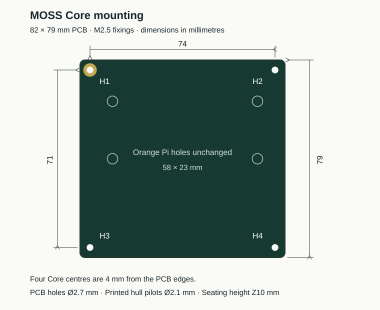

# MOSS V0.7 hull — 74 × 71 mm Core mounting

This hull matches the **82 × 79 mm MOSS Core PCB**. Three floor bosses move to the new mounting pattern; the fourth stays in place. The five integral cable-tie bridges and the rounded battery-divider wire notch are retained.

| File | Contents |
|---|---|
| [Print STL](stl/Hull_MOSS_V07_Harness_Tie_Loops_PROTOTYPE.stl) | Current hull, five tie bridges and wire notch |
| [Editable solid STEP](cad/Hull_MOSS_V07_Harness_Tie_Loops_PROTOTYPE.step) | Same complete hull geometry |
| [Base F3D](cad/Hull_MOSS_V07_Core_74x71_EDITABLE.f3d) | Current mounting hull before tie bridges and notch; imported editable BRep, without reconstructed parametric history |
| [Checks](evidence/FINAL_HULL_ARTIFACTS.json) | Exact file hashes and source PCB |



## Mounting

The PCB bottom stays at **Z = 10 mm**. Boss shape and **Ø2.1 mm blind printed pilots for M2.5 screws** are unchanged. These are prototype screw pilots, not heat-set insert seats. The pilot tool runs from Z4 to Z10.2 mm; the physical post ends at Z10 mm.

| Hole | Native KiCad X, Y (mm) | Hull X, Y (mm) |
|---|---|---|
| H1 — PCB GND fixing | 2, 0 | −76, 37 |
| H2 | 76, 0 | −2, 37 |
| H3 | 2, 71 | −76, −34 |
| H4 | 76, 71 | −2, −34 |

Transform: `hull_x = pcb_x − 78`, `hull_y = 37 − pcb_y`, in millimetres. Native PCB outline: X = −2…80, Y = −4…75. See the [Core mounting drawing](../../electronics/moss-core-v0.7/MOUNTING.md). H1 is grounded on the PCB; the plastic hull does not provide an electrical ground connection.

The Orange Pi mounts, hub supports, centred Cytron support, motor interfaces, fan clips, battery bay and native shell thicknesses remain unchanged. Physical screw engagement and printed fit still need an assembly test.

## Source and rebuild

`reference/` contains the exact prior hull STEP/STL, original R92 floor reference and previous parameters. `source/mechanical_parameters.json` describes the current pattern.

The BRep script removes only the three old boss additions while preserving the original floor, restores the small floor lips previously cut by their pilots, and adds identical bosses at the new centres. Fusion exports a new high-quality native STL from that checked STEP. One inherited rim vertex pair is welded by **0.00000853 mm**. The tie and notch operations then use local mesh Booleans. There is no voxelisation, smoothing or hole filling. A new native tessellation preserves the CAD geometry, but does not preserve the old STL vertex list.

Install the Python dependencies in [requirements.txt](requirements.txt). With Fusion running and its local MCP API available:

```sh
python source/rebuild.py --fusion-endpoint http://127.0.0.1:27182/mcp
```

The local port can change after Fusion restarts. Alternatively, import `cad/Hull_MOSS_V07_Core_Stack.step` into Fusion and export its single hull body as a high-quality binary STL in millimetres to `stl/Hull_MOSS_V07_NATIVE_MATCHED.stl`, then run `python source/weld_native_mesh.py`. Once the STEP, native mesh and F3D exist, `python source/rebuild.py --resume-after-native-mesh` rebuilds only the ties and notch. Generated intermediate files go under `harness/assets/` and `harness/output/`; published final files are copied to `cad/`, `stl/` and `preview/`.

The optional `source/FusionV07Hull/` recipe preserves the native R92-based construction. The active BRep rebuild does not depend on recreating that history. [Geometry evidence](evidence/LOCAL_CORE_MOUNT_REFRESH.json), [native export](evidence/FUSION_NATIVE_PRINT_EXPORT.json), [mesh weld](evidence/LOCAL_WELD_QA.json), [tie checks](evidence/hull_tie_variant_QA.json) and [notch checks](evidence/DIVIDER_WIRE_NOTCH_QA.json) record their individual scopes. `MANIFEST.json` inventories this source package.

MOSS hardware designs follow [CC BY-NC-SA 4.0](../../../LICENSE-HARDWARE). Code remains Apache-2.0; documentation and media remain CC BY 4.0, as described in the repository [NOTICE](../../../NOTICE). Third-party notices retain their own terms.
