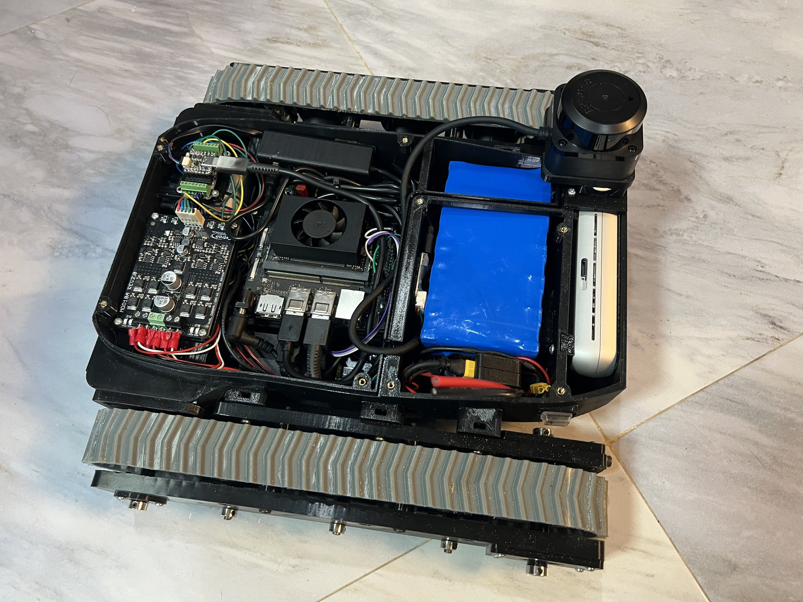
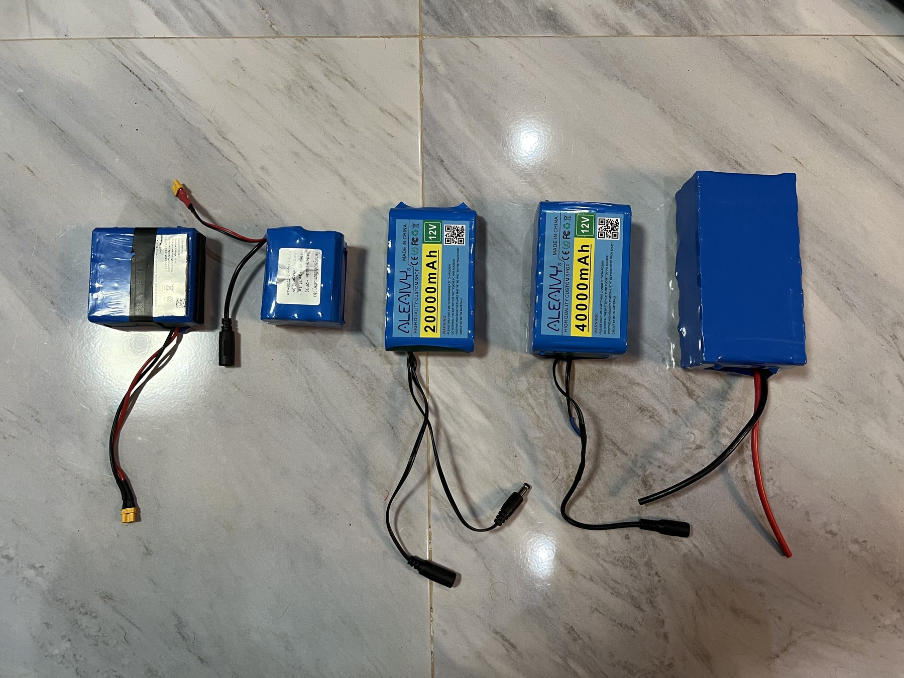
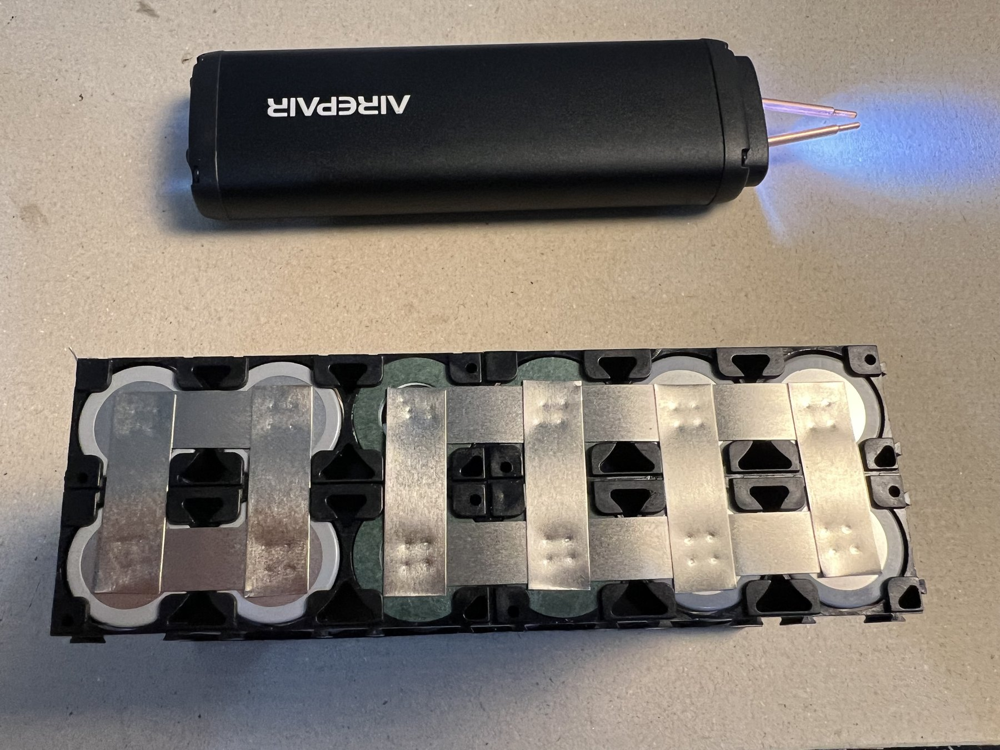
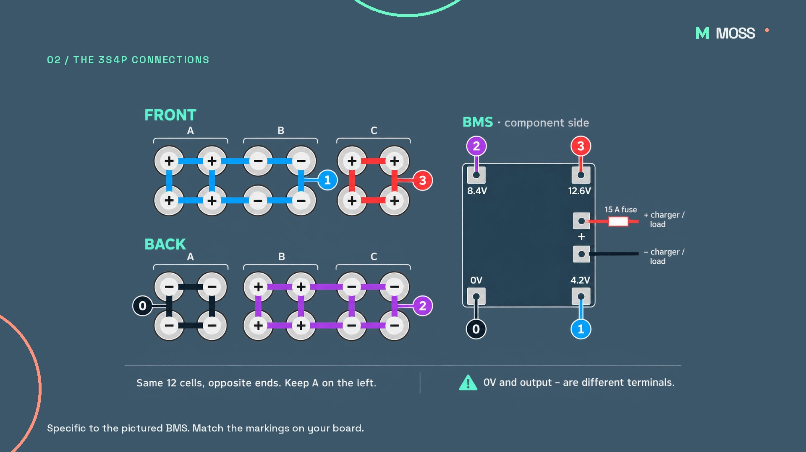
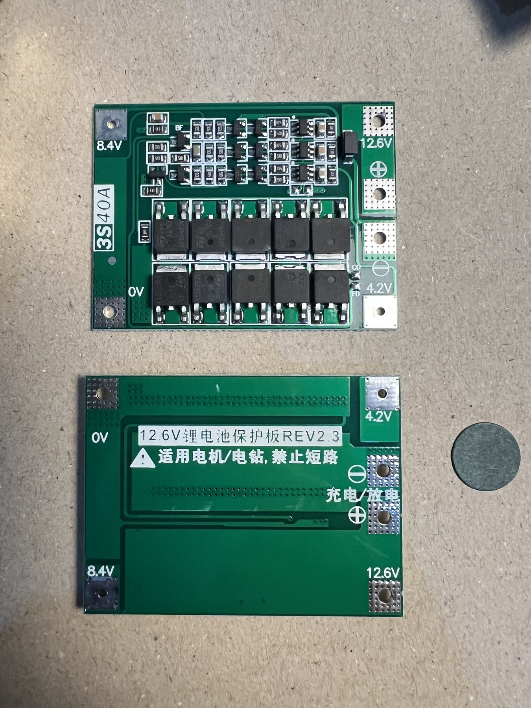
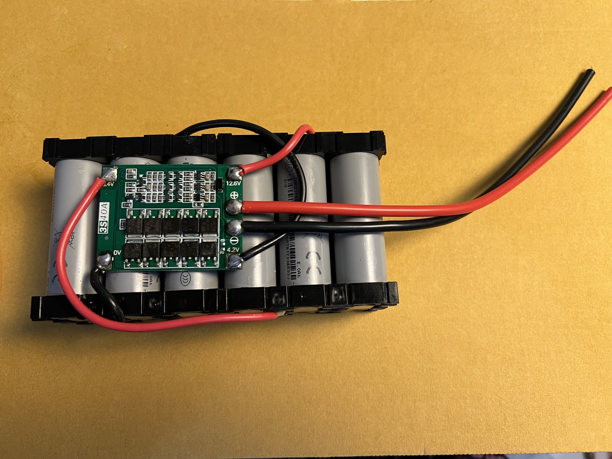
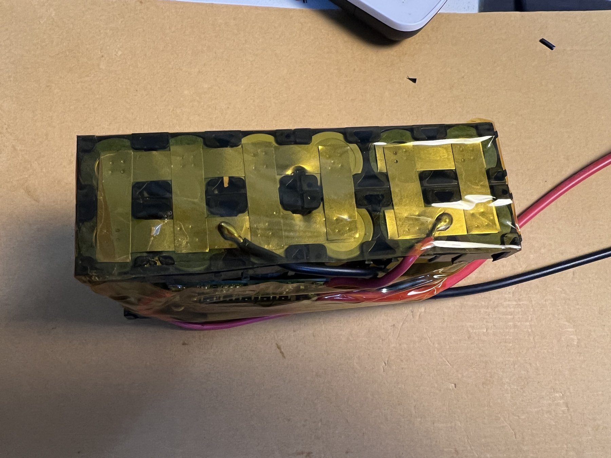
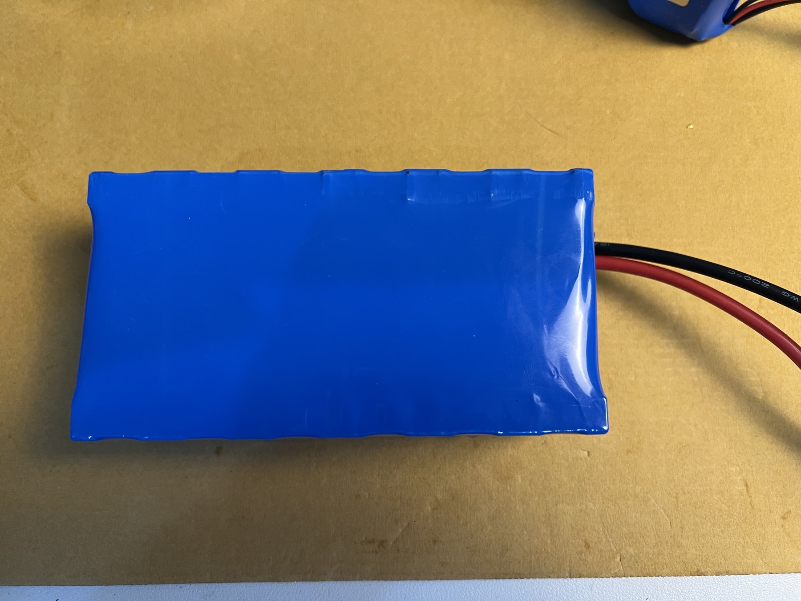
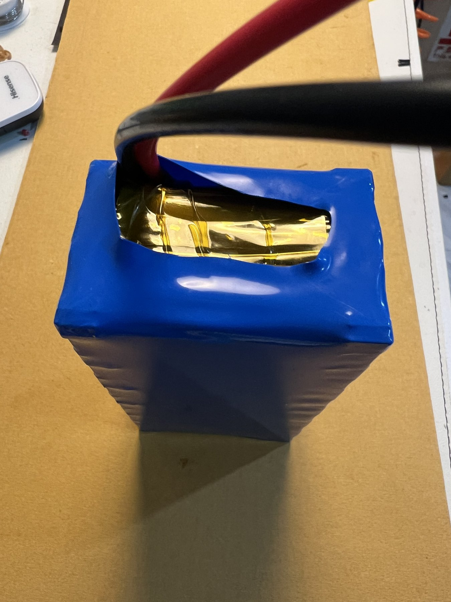

# Building a custom battery for MOSS

> [!WARNING]
> **I'm not an engineer — this is a hobby project. Do not copy this build unless you have the skills and equipment to work safely with lithium-ion cells. They can catch fire and release dangerous gases. Work outdoors, in a dry area away from flammable materials, on a firebrick or another non-combustible surface. Wear appropriate eye protection and gloves, and use insulated tools.**

MOSS, the litter-picking rover, needed a better battery. This is how I built a **3S4P pack from twelve EVE 21700 cells**, with a BMS, a 15 A blade fuse and **12 AWG main power leads**. The enclosed inline fuse holder has **14 AWG pigtails**.

The pack is assembled and fitted in the rover. Its **20 Ah rating comes from the cell specifications**; usable energy and collection runtime still need measuring. This guide records the workshop build, including the details still missing before someone can reproduce it exactly.



**[Watch or download the 61-second workshop film](video/moss-battery-build.mp4)** — silent edition. **[Parts](#parts-for-one-pack) · [Assembly](#assembly) · [Wiring diagram](#4-wire-the-bms) · [Testing](#8-charge-and-test) · [Open measurements](#what-still-needs-measuring)**

*Build update: the film shows the original assembly. Its “14 AWG leads” caption needs correcting to **12 AWG for the main power wires**; only the fuse-holder pigtails are 14 AWG. The 120 mm sleeve was difficult to fit, so the parts list now specifies 130 mm.*

## Why I made one

I tried several inexpensive packs before building this one. One was labelled **40,000 mAh**, weighed **420 g**, and cost me about **US$24**. In use, I got roughly **30 minutes**, and its voltage dropped quickly when the motors worked hard. I also found that charging did not take it above 12 V.

My estimate is **4–5 Ah at the pack's 12 V-class voltage**, but I have not measured its discharge capacity. Weight, price and voltage alone do not prove capacity, and the charging ceiling can also depend on the charger, BMS and cell balance. These are my observations from that pack, not a test of every battery on the market.



## What this pack contains

| Property | Value | Basis |
|---|---|---|
| Cells | 12 × EVE INR21700/50E, 5 Ah each | Ordered model; cells not independently capacity-tested |
| Configuration | 3S4P | Three groups in series, four cells in parallel per group |
| Rated capacity | 20 Ah | 4 × 5 Ah |
| Nominal voltage | 10.95 V | 3 × 3.65 V |
| Full-charge voltage | 12.6 V | 3 × 4.2 V |
| Nominal energy | 219 Wh, approximately 220 Wh | 12 × 3.65 V × 5 Ah |
| Usable-energy budget | Approximately 175–180 Wh | Assumed 80% of nominal energy; not measured |
| Finished mass | 910 g | Workshop measurement |
| Finished dimensions (L × W × H) | **140 × 73 × 48 mm** | Workshop measurement |
| Build cost | About US$65–70 | Reported cost; reusable tools not separately itemized |
| Output fuse / main wires | 15 A blade fuse / 12 AWG | Used for this build |
| Inline fuse-holder pigtails | 14 AWG | Enclosed motorcycle-style holder |
| Collection-runtime target | 1.5–2 hours | Estimate; actual collection test pending |

The cell voltage and capacity are from [EVE's 21700 50E specifications](https://www.evemall.eu/consumer-battery/cylindrical-ncm-cell/21700-50e). This is a **12 V-class battery with a varying output voltage**, not a regulated 12 V supply. Do not multiply 20 Ah by the full-charge voltage to describe its nominal energy.

An approximately 180 Wh usable budget would support 1.5–2 hours only if average consumption is about 90–120 W. Track tension, terrain, computer load and arm use all matter; the new pack has not yet been compared with the old one under the same conditions.

## Parts for one pack

| Quantity | Part | Specification / selection note |
|---:|---|---|
| 12 | EVE INR21700/50E cells | Matched, genuine 21700 lithium-ion cells, rated 5 Ah |
| 8 | Three-slot 21700 cell holders | 24 slots total, supporting both ends of the twelve cells |
| 1 | 3S lithium-ion BMS | The pictured board is marked **3S40A**, 12.6 V, REV2.3, with common charge/discharge output. [Ordered board](https://www.lazada.co.th/products/i4970988029-s20928330051.html) |
| As needed | Spot-welding strip | Alloy, width and thickness were not recorded; select interconnects for the actual current and welding equipment |
| 2 short lengths | Midpoint voltage-sense wires | **22 AWG stranded copper recommended** for the 4.2V and 8.4V taps, subject to the board's balance-current and insulation requirements; actual prototype gauge unknown |
| As needed, red + black | Main power wire | **12 AWG**, cut to the routing; use power-rated wiring for pack-to-BMS and output connections |
| 1 | Enclosed inline blade-fuse holder | Motorcycle-style holder with **14 AWG pigtails**, suitable for the DC circuit and 15 A fuse |
| 1 | Blade fuse | **15 A**, automotive/motorcycle type; match the blade size to the holder |
| 1 matched set | Power connector | Match the rover harness and its current requirement; exact connector fitted to this pack not yet recorded |
| 12 | Positive-terminal insulating rings | Battery-grade rings for the positive rims of the cells |
| 1 sheet, cut as needed | **Fishpaper electrical insulation** | Battery-grade sheet for barriers around interconnects and beneath the BMS; keep metal edges from rubbing through insulation |
| As needed | Polyimide tape | Kapton tape was already available and used in this build |
| 1 sleeve | Blue PVC battery heat-shrink | **130 mm flat width**, cut to length; the original 120 mm sleeve fitted only with difficulty |
| As needed | Small heat-shrink and strain relief | Cover wire joints and keep cable pull off the board pads |
| 1 | 3S lithium-ion CC/CV charger | Ordered listing: **12.6 V, 5 A**. Confirm the actual plug, polarity and suitability for the assembled pack. [Charger listing](https://www.lazada.co.th/products/pdp-i4692319951-s19334045449.html) |
| As needed | Thin nonconductive foam / self-adhesive hook-and-loop pads | Cushion hull contact points and help prevent rubbing or sliding |
| 1 arrangement | Pack restraint / protective mounting | Retain the 140 × 73 × 48 mm, 910 g pack securely, without squeezing it; keep ventilation clear |

Two BMS boards were ordered, but **one is used per pack**. The other is a spare. The “40 A” printing is a board claim, not a verified continuous-current rating for the complete battery. The fuse, strips, wires, connectors and board must be considered together.

The prototype's midpoint sense wires were thicker than 22 AWG because that was what I had available; their exact gauge is unknown. **22 AWG is a recommended purchase size, not a claim about the wire in the photos.** It is a common cell-tap size, as illustrated by [Orion's sense harnesses](https://www.orionbms.com/manuals/pdf/orionbms2_purchasing_guide.pdf); the selected BMS's balance current and wire requirements still take precedence. On this board, **0V and 12.6V are also pack-current connections**: do not use the small midpoint sense wires for them. See [Prohelion's distinction between sense and main-current wiring](https://docs.prohelion.com/Battery_Management_Systems/Prohelion_BMS_M48_Gen1/Generic_Battery_Assembly_procedure.html).

The existing [rover BOM](../../../BOM.md#power-and-wiring--module-based-rover) lists XT30 connectors. That does not confirm the connector on this new battery. Do not assume a barrel charging connector is suitable for the full rover current.

### Tools

- An **AIRepair handheld spot welder**, fully charged before welding. The successful setting on this build was **5 out of 8 at 100% charge**.
- A multimeter, wire cutters and strippers, insulated tools, eye protection and suitable gloves.
- A soldering iron for **wires and board pads**, not for soldering directly onto cells.
- A suitable heat source for the sleeve and a dry outdoor workspace with a firebrick or other non-combustible work surface.

## Assembly

### 1. Inspect the cells and lay out the holders

Inspect each cell and wrapper. Do not use damaged cells. Measure and record the cell voltages, and use matched cells at closely matched states of charge before connecting them in parallel. Do not use the interconnect strips to equalize mismatched cells.

Arrange the twelve cells as **two rows of six**. Four cells make each group: A, B and C. Each group occupies two columns. Eight three-slot holders support the two ends of the pack; these holders position the cells and do not make electrical connections.

Dry-fit the assembly and its insulation in the intended battery space before welding. This finished custom pack measures **140 mm long × 73 mm wide × 48 mm high**. Allow extra room for the leads and any cushioning or retaining strap. The **110 × 67 × 35 mm** dimension in the older rover BOM refers to the earlier compact pack, not this one.

### 2. Orient the groups and spot-weld the interconnects

Use the [diagram below](#4-wire-the-bms) as the orientation reference. Looking at its **FRONT** view, both rows read:

```text
Group:      A A    B B    C C
Cell ends:  + +    − −    + +
Cell ends:  + +    − −    + +
```

The **BACK** view is the opposite end of the same cells. Keep A on the left as drawn; flipping the pack top-to-bottom preserves that convention. Its signs are reversed:

```text
Group:      A A    B B    C C
Cell ends:  − −    + +    − −
Cell ends:  − −    + +    − −
```

Fit the positive-end insulating rings and fishpaper barriers before working on the connections. Establish suitable weld settings on a representative test sample using the welder and cell guidance. Spot-weld the interconnects without bridging adjacent electrical nodes. Keep unused conductive areas covered while working.

**What worked in this build:** I used an **AIRepair** welder at **level 5 of 8**. When it arrived showing **three battery bars**, the welds did not hold well. I charged it to **100%**, kept the same level 5 setting, and the welds held well. This is my workshop observation with this tool and strip, not a universal setting or a measured weld-strength result. Check adhesion on a representative test sample, and recharge/recheck if weld quality drops.

The four electrical nodes are:

- **0:** group A negative.
- **1:** group A positive joined to group B negative.
- **2:** group B positive joined to group C negative.
- **3:** group C positive.



*Workshop photo of one end after welding. Use the node diagram for electrical connections; the photographs show intermediate, partly uninsulated stages.*

### 3. Check the group voltages

Before connecting the BMS, measure adjacent nodes: **0→1**, **1→2**, and **2→3**. Each should show the voltage of one parallel group, with the expected positive polarity and closely matched readings. Then measure the cumulative voltages from node 0 to nodes 1, 2 and 3.

The BMS markings **4.2 V, 8.4 V and 12.6 V are full-charge values**. Partly charged cells should read lower. A reversed reading or an unexpected group voltage needs resolving before connecting the board.

### 4. Wire the BMS



**This diagram is specific to the photographed board.** Match the markings on the actual board and obtain its supplier's connection sequence. The table is a node mapping, not a universal connection order for every BMS.

| Pack connection | Marking on this BMS | Meaning |
|---|---|---|
| Node 0 | 0V | Group A negative / battery negative; main-current connection, use power wire |
| Node 1 | 4.2V | Junction between groups A and B; midpoint sense wire |
| Node 2 | 8.4V | Junction between groups B and C; midpoint sense wire |
| Node 3 | 12.6V | Group C positive / battery positive; main-current connection, use power wire |
| Protected positive output | + | Positive lead, through the 15 A fuse |
| Protected negative output | − | Negative lead for the rover and compatible charger |

**Cell negative (0V / B−) and protected output negative (P−) are different connections. Do not bridge them and bypass the BMS.** The photographed board has common charge/discharge output pads; other boards may differ.

Position the BMS on a fishpaper insulating barrier so its underside cannot contact cell cans or strips. Route group wires clear of sharp edges and support them so they cannot pull on the pads.





### 5. Add the fuse and output connection

Use **12 AWG main power leads**. The **14 AWG wires belong to the enclosed inline motorcycle-style fuse holder**, which takes the **15 A blade fuse**. Install it in the positive output, close to the pack, protecting the cable run. Use connections suitable for joining the 12 AWG leads to the holder's 14 AWG pigtails, and insulate and secure the unfused section too. Fit a keyed connector that matches the rover harness and is rated for the current. Confirm polarity with a meter before connecting anything.

The charger listing says 12.6 V / 5 A, but its plug dimensions and polarity still need recording. Mechanical fit alone does not establish electrical compatibility. Keep charging and rover-current connector ratings separate when selecting the harness.

### 6. Insulate and wrap

Cover exposed interconnects, wire joints and board contacts with suitable insulation. Add **battery-grade fishpaper** where a protective barrier is needed around the interconnects and beneath the BMS. Keep the positive-terminal insulating rings in place; thin tape alone is not a substitute where an edge can rub or puncture it.



Choose **130 mm flat-width PVC heat-shrink** for this build, equivalent to about **260 mm circumference before shrinking**. I managed to fit the original **120 mm** sleeve, but it was too tight to install comfortably. The photos therefore show the earlier sleeve; 130 mm is the revised recommendation. Check clearance around the BMS, fishpaper and leads before shrinking. Use controlled heat according to the sleeve instructions and avoid prolonged heating of the cells.

The end openings must remain electrically protected. Provide strain relief for the leads. The photos document the build; they do not establish that every underlying insulation layer has been checked.





### 7. Secure it inside MOSS

Restrain the battery so it cannot slide into electronics or moving parts. Keep cables clear of sharp edges, fan openings and the cover. Do not use the output wires as a restraint or compress the cells to make the pack fit.

**Thin nonconductive foam** at hull contact points can cushion the pack and reduce abrasion of the sleeve. **Self-adhesive hook-and-loop pads (Velcro)** can help prevent it sliding. Use only the padding needed, keep ventilation clear, and verify that the adhesive remains secure. A retaining strap or suitable carrier should hold the pack's weight; cushioning alone is not a restraint.

The assembled pack weighs **910 g** and measures **140 × 73 × 48 mm (L × W × H)**. Check clearance with the cover closed, including leads, foam and fastenings. Keep the rover's existing fuse, switching and emergency-stop arrangement functional.

### 8. Charge and test

Use a compatible **3S lithium-ion CC/CV charger with a 12.6 V endpoint**. Confirm the allowed charging current for the complete pack, not just the individual cells. Attend the first charge in the same dry outdoor, non-combustible workspace, checking group voltages and abnormal heating; do not continue charging an abnormal pack.

For the first rover test, support the rover so the tracks can move clear of the work surface, and keep a way to stop it immediately. Check operation at low load before a normal collection run.

Measure delivered **Wh and Ah**, voltage under load, runtime and the operating conditions with a suitable logger. An instantaneous voltage reading is not a capacity measurement. Respect the battery and rover operating limits; do not bypass the BMS or discharge until the computer crashes to extend a runtime result.

## What still needs measuring

The **1.5–2 hour collection target is not a demonstrated result**. The pack's next useful test is a real MOSS run with the load and terrain recorded.

| Record | Current status |
|---|---|
| Finished mass | 910 g |
| Final external dimensions | 140 × 73 × 48 mm (L × W × H) |
| Retaining method | Thin foam / adhesive hook-and-loop suggested; verify secure restraint in the actual rover |
| Installed power/charge connectors and polarity | Exact references not recorded |
| Strip material, width and thickness | Not recorded |
| Midpoint sense-wire gauge in the prototype | Unknown; 22 AWG is recommended for short sense taps, subject to the BMS requirements |
| Insulation coverage, strain relief and BMS thermal behavior | Full verification not recorded |
| Starting / ending voltage of each series group | Test pending |
| Delivered Wh and Ah | Test pending |
| Average and peak current, voltage sag, temperatures | Test pending |
| Runtime, terrain, track tension, computer and arm duty | Collection test pending |

## Sources and media

- [EVE 21700 50E manufacturer specifications](https://www.evemall.eu/consumer-battery/cylindrical-ncm-cell/21700-50e).
- [Ordered BMS listing](https://www.lazada.co.th/products/i4970988029-s20928330051.html) and [charger listing](https://www.lazada.co.th/products/pdp-i4692319951-s19334045449.html). Listing titles identify the items; they are not independent electrical test results.
- Laurent's order screenshots, workshop photos and observations, October 2026.
- [Battery and charging safety — Fire and Rescue NSW](https://www.fire.nsw.gov.au/fire-safety/home-fire-safety/battery-and-charging-safety).

Photos © 2026 Laurent Genoud / SHOW ROBOTICS. Wiring illustration generated with imagegen and checked against the supplied drawing and BMS photo. Images are resized exports of the originals, with camera metadata removed. The video is the silent edition of the workshop film. Documentation and media follow the repository's [CC BY 4.0 notice](../../../NOTICE).

[Back to hardware](../../README.md) · [Rover BOM](../../../BOM.md) · [MOSS assembly guide](../../../Assembly.md)
