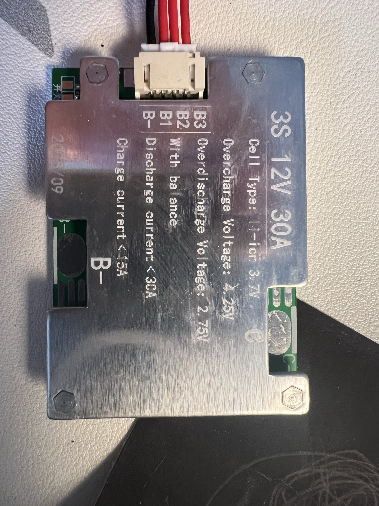
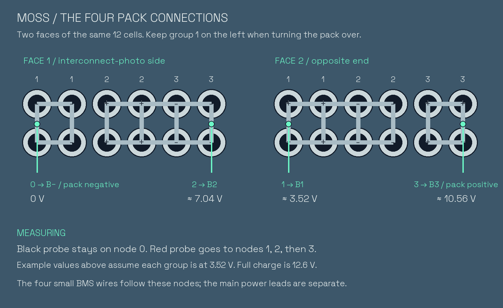
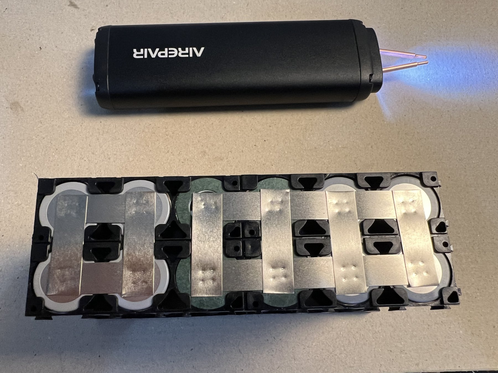
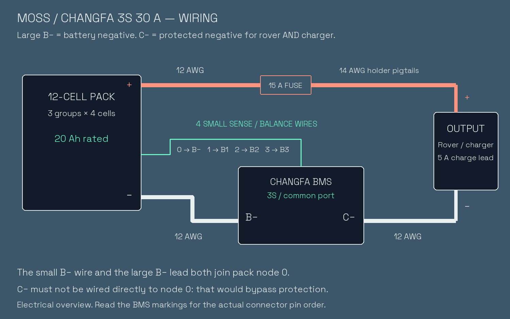
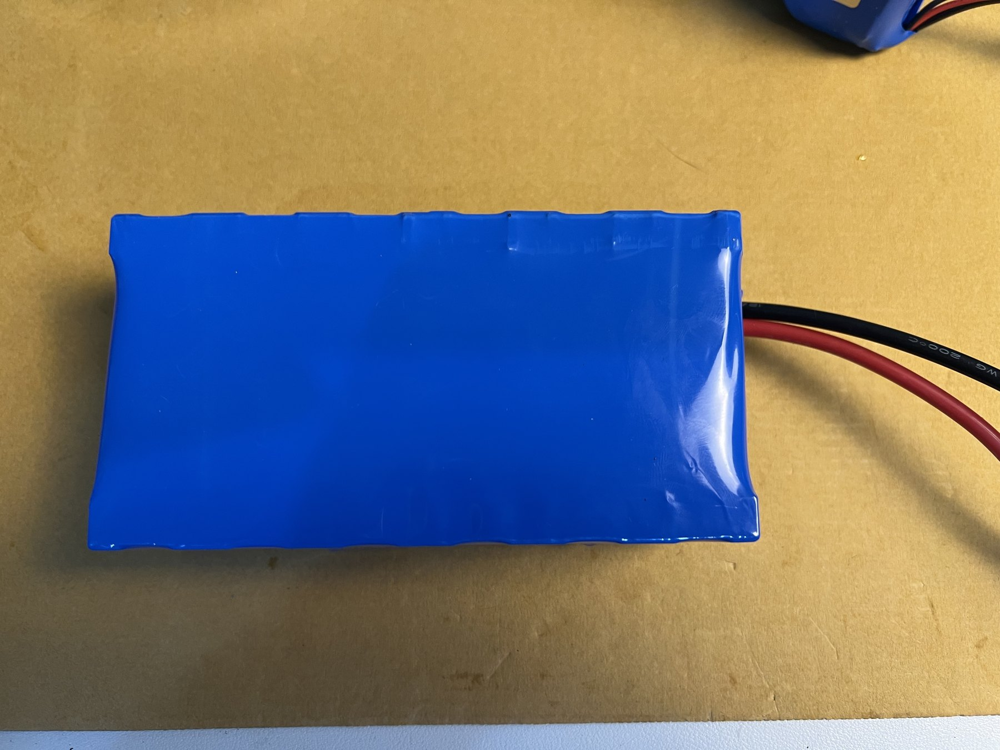
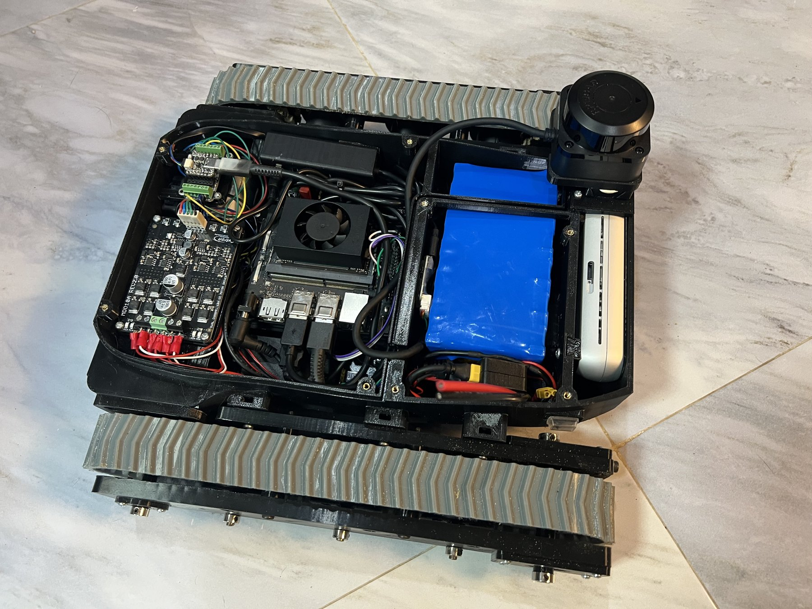

# Building a custom battery for MOSS

**Twelve EVE 50E cells, a ChangFa balancing BMS and a 15 A fuse.** This guide covers the complete 3S4P pack: cell layout, welding, voltage checks, BMS wiring, insulation and first charge.

*Workshop photo. Choose the **3S / 12.6 V / 30 A Li-ion** version of this [ChangFa BMS](https://www.lazada.co.th/products/i5333364901-s22669715856.html), supplied by MookMig ToolShop.*

> [!WARNING]
> **I'm not an engineer; this is a hobby project. Do not reproduce it without the skills and equipment to work safely with lithium-ion cells. They can catch fire and release dangerous gases. Work outdoors in a dry area away from flammable materials, on a firebrick or another non-combustible surface. Wear eye protection and suitable gloves, and use insulated tools.**

[Parts](#parts-for-one-pack) · [Cell layout](#2-arrange-and-spot-weld-the-cells) · [Voltage checks](#3-check-the-three-groups) · [BMS wiring](#4-connect-the-four-small-wires) · [Power wiring](#5-connect-the-main-power-wires) · [First charge](#7-activate-the-bms-and-charge)

## The pack

| Item | Specification |
|---|---|
| Cells | 12 × EVE INR21700/50E, 5 Ah each |
| Arrangement | **3S4P:** three groups in series, four cells in parallel per group |
| Rated capacity | **20 Ah**, calculated from the cell ratings |
| Nominal voltage / energy | **10.95 V / 219 Wh**, about 220 Wh |
| Fully charged | **12.6 V**, or 4.2 V per group |
| BMS | **ChangFa 3S 30 A Li-ion, with passive balancing** |
| Charge and discharge | Shared negative terminal, **C−** |
| Main power leads | **12 AWG** |
| Output protection | **15 A blade fuse**, enclosed inline holder with **14 AWG pigtails** |
| Output connector | **XT30**, matching the rover harness |
| Charger | **12.6 V / 5 A, 3S Li-ion CC/CV** |

The [EVE specifications](https://www.evemall.eu/consumer-battery/cylindrical-ncm-cell/21700-50e) give 3.65 V nominal, 5 Ah and a 4.2 V charge endpoint per cell. This is a **12 V-class pack**, not a regulated 12 V supply. Its capacity and runtime still need a discharge test. An approximately 175–180 Wh usable-energy budget and 1.5–2 hours of collection are planning estimates.

## The balancing BMS

The supplier lists **35 mA passive balancing**, a supplied four-wire sense harness, common charge/discharge connections and no app or adjustable settings. The photographed 3S 30 A board is marked for Li-ion cells, with discharge current below 30 A and charge current below 15 A. These are supplier ratings, not a current qualification of the assembled pack.

Balancing slowly bleeds charge from higher-voltage groups when its balancing conditions are met. It helps keep matched groups aligned; it does not make badly mismatched or damaged cells suitable for a pack. Start with closely matched cell voltages.

**Select 3S / 12.6 V / 30 A Li-ion.** The same listing also sells 4S and LiFePO4 variants, which have different voltage limits.

## Parts for one pack

| Quantity | Part | Specification |
|---:|---|---|
| 12 | EVE INR21700/50E cells | Genuine, matched 21700 Li-ion cells, rated 5 Ah |
| 8 | Three-slot 21700 holders | Supports for both ends of the twelve cells |
| 1 | [ChangFa BMS](https://www.lazada.co.th/products/i5333364901-s22669715856.html) | **3S / 12.6 V / 30 A Li-ion**, with balancing and four-wire harness |
| As needed | Spot-welding strip | Select material, width and thickness for the load and welding equipment |
| 1 | Supplied BMS sense harness | Four small wires: **B−, B1, B2, B3** |
| As needed | Main power wire | Red and black **12 AWG** stranded copper |
| 1 | Enclosed inline blade-fuse holder | Motorcycle-style holder with **14 AWG pigtails** |
| 1 | Blade fuse | **15 A**, matching the holder |
| 1 matched set | XT30 power connectors | Match the rover polarity; insulate all solder joints |
| 1 | Charging inlet / adapter and cable | Rated for **at least 5 A continuous** as a complete assembly; match the charger plug dimensions and polarity. Select adequate wire for length and installation, and fuse the charge branch to suit its wiring and inlet rating |
| 12 | Positive-terminal insulating rings | Battery-grade rings for the positive cell rims |
| As needed | Fishpaper | Interconnect barriers, cell-end protection and insulation beneath the BMS |
| As needed | Polyimide / Kapton tape | Secure insulation and cover exposed connections |
| 1 sleeve | PVC battery heat-shrink | **130 mm flat width**, cut to length and checked against the assembled pack |
| As needed | Small heat-shrink and strain relief | Insulate joints and keep cable pull off the solder pads |
| 1 | [Li-ion charger](https://www.lazada.co.th/products/pdp-i4692319951-s19334045449.html) | **3S CC/CV, 12.6 V / 5 A**; verify actual output and plug polarity |
| As needed | Thin nonconductive foam / hook-and-loop pads | Cushion contact points inside MOSS |
| 1 | Strap or battery retainer | Secure the pack without compressing the cells |

The rover current runs through the **12 AWG leads, BMS power path, fuse and XT30**. The four small wires only serve voltage sensing and balancing. Do not substitute them for the main power connections.

### Tools

- AIRepair handheld spot welder, fully charged, with suitable strip and a representative weld test sample.
- Multimeter, insulated tools, wire cutters and strippers.
- Soldering iron for wires and board pads, **not for soldering directly to cells**.
- Suitable heat source for the sleeve, eye protection and gloves.

## Assembly

### 1. Inspect the cells and dry-fit the pack

Inspect the wrappers and terminals. Reject damaged cells. Measure each cell and record its voltage before assembly. The cells used here were around **3.52 V each**. Match the voltages closely before connecting cells in parallel; do not use the nickel strips to equalize mismatched cells.

Dry-fit the holders, BMS, insulation and leads in the battery space. The workshop pack envelope was **140 × 73 × 48 mm (L × W × H)** and its recorded mass was **910 g**. Check the final wrapped size and mass of your own assembly, including the BMS, padding and cable exits.

### 2. Arrange and spot-weld the cells

Arrange the cells as **two rows of six**. Each group occupies two columns, so each group contains four cells. The middle group faces the opposite direction to the two outer groups.

The drawing shows **both ends of the same twelve cells**. Keep group 1 on the left when turning the pack over. Face 1 matches the interconnect photo below.

| Node | Electrical connection |
|---|---|
| **0** | Group 1 negative; total pack negative |
| **1** | Group 1 positive joined to group 2 negative |
| **2** | Group 2 positive joined to group 3 negative |
| **3** | Group 3 positive; total pack positive |

Fit the positive-terminal insulating rings and fishpaper barriers. Keep conductors you are not working on covered. Establish suitable weld settings on a test sample, then spot-weld the interconnects without bridging separate nodes.

**Workshop setting:** the AIRepair welder worked well at **5 out of 8**, with its battery charged to **100%**. At three charge bars, the same setting produced weak welds. This is a starting observation for that tool and strip, not a universal setting. Check a representative weld sample and recharge/recheck if weld quality drops.

### 3. Check the three groups

Keep the BMS, charger and rover disconnected. Use **DC volts**, with the meter's black lead in **COM** and red lead in **V**, not the current socket. Do not bridge adjacent conductors with a probe.

First measure each group directly: **0→1**, **1→2**, **2→3**. Each should have positive polarity and a closely matched voltage.

Then keep the black probe on node 0 and move the red probe in sequence:

| Red probe | Example with three groups at 3.52 V |
|---|---:|
| Node **1** | **3.52 V** |
| Node **2** | **7.04 V** |
| Node **3** | **10.56 V** |

These are partly charged example readings. **12.6 V is the full-charge voltage**, not the expected reading for three groups at 3.52 V. Resolve unexpected readings before connecting the BMS.

### 4. Connect the four small wires

**Unplug the white four-pin connector from the BMS before soldering.** Identify the wires from the board's **B− / B1 / B2 / B3 markings** and trace each wire; do not infer pin order from a flipped view of the loose plug.

| Small harness wire | Pack node |
|---|---|
| **B−** | **0** — total negative |
| **B1** | **1** — first junction |
| **B2** | **2** — second junction |
| **B3** | **3** — total positive |

Solder these wires to the interconnects, not directly to the cell cans. Insulate and secure each connection. Keep the connector unplugged while working.

At the loose connector, measure **B−→B1**, **B−→B2**, **B−→B3**. They must reproduce the readings measured directly on the pack. Also check adjacent contacts: **B−→B1**, **B1→B2**, **B2→B3** should each show one group's voltage. Do not force oversized probes into the plug or bridge neighboring contacts.

### 5. Connect the main power wires

| Connection | Destination |
|---|---|
| **Large B− pad on the BMS** | Node **0**, using a **12 AWG** power lead |
| **Large C− pad on the BMS** | Negative of the rover connector and charger connection |
| **Node 3, pack positive** | **15 A inline fuse**, then positive of the XT30 output / charge adapter |

**Both the small B− wire and the large B− power lead go to node 0. The rover and charger negatives go to C−, not node 0.** Joining C− directly to node 0 bypasses the BMS protection.

Keep the white sense connector unplugged until its checks and the large B− connection are complete. Following the supplier's sequence:

1. Finish the four sense-wire connections with the connector unplugged.
2. Prepare the **C−** output lead and fused positive lead, with no charger or rover attached. Insulate the connections and verify XT30 polarity.
3. Connect the large **B−** pad to total pack negative, node 0.
4. Recheck the sense-harness voltage order, then insert the white connector into the BMS without forcing it.

Use **12 AWG main leads**; the fuse holder's **14 AWG pigtails** remain part of the fused positive path. Place the 15 A fuse close to pack positive, and insulate the short unfused section. Make sound joints with the wires seated against their pads, and provide strain relief. Do not let the iron dwell on the board or heat the cells.

**Charging inlet:** a DC barrel jack may be used only when both mating contacts and the complete cable assembly are rated for at least **5 A continuous**. Correct plug fit and thick-looking insulation do not establish that rating. For a separate charging branch, size its wire and fuse for the inlet and cable; the 15 A main fuse is not a substitute for appropriately protecting a smaller branch. Verify the supplier's contact and wire specifications. Stop charging if a charging lead or connector becomes unusually warm; replace the complete underspecified inlet/lead assembly rather than only fitting thicker wire to an underrated contact.

The board's 30 A marking is not permission to uprate the 15 A fuse. The complete current path, including strips, connectors and wiring, sets the pack's usable limits.

### 6. Insulate and wrap

Place a **fishpaper barrier beneath the BMS**, including beneath its metal plate, so it cannot contact cell cans or strips. Cover exposed interconnects and solder joints, retain the positive-end rings and protect wires from sharp edges. Thin tape alone is not a barrier against metal edges rubbing through insulation.

Dry-fit **130 mm flat-width heat-shrink**, approximately 260 mm circumference before shrinking, around the complete assembly. A 120 mm sleeve was too tight for comfortable installation. Allow room for the BMS, insulation and wire exits. Shrink according to the sleeve instructions without prolonged heating of the cells. Keep end openings electrically protected and support the cables independently of the pads.

### 7. Activate the BMS and charge

First compare these two **DC voltage** readings with the charger disconnected:

| Measurement | Probe positions |
|---|---|
| Pack / BMS input | Red on node **3**, black on the **large B− pad** |
| Protected output | Red on node **3**, black on **C−** |

They should be approximately equal when the BMS output is active. The supplier says that **if they differ after wiring checks, connect the compatible charger to activate the circuit**. A low output reading alone does not prove a cell group is at that voltage.

With the charger unplugged from the mains, connect its **positive to the fused pack positive** and its **negative to C−**, through correctly polarized, insulated connectors and a suitably rated charging lead. Use the **12.6 V / 5 A 3S Li-ion CC/CV charger**. Energize briefly, then disconnect it **from the pack** and repeat the output measurement. The protected output should now match pack voltage. If it still does not, disconnect the charger and troubleshoot the connections and board; do not bridge B− to C− or use a prolonged charge as a remedy.

Attend the first charge in the dry outdoor, non-combustible workspace. Check for abnormal heating, damage or odor; stop if anything is abnormal. After 5–10 minutes, disconnect the charger from the pack, let the voltage settle briefly and record it. A rise is useful evidence of charging, but a red charger light alone does not measure current or capacity.

At an actual 5 A, ten minutes adds about **0.83 Ah**, roughly **4% of the rated 20 Ah**. Voltage does not rise linearly with charge, so there is no fixed ten-minute voltage target. Near full charge, the charger holds up to **12.6 V** and current tapers. The BMS's printed **4.25 V overcharge threshold is a protection limit, not the charging target**.

### 8. Secure it in MOSS and test under load

Use a strap or retainer so the pack cannot slide into moving parts or electronics. Thin nonconductive foam and self-adhesive hook-and-loop pads can reduce rubbing and sliding; padding alone should not carry the pack's weight. Check the cover clearance without compressing the cells. Keep wires clear of fan openings and sharp edges.

For the first powered rover test, support it so the tracks are clear of the surface and keep an immediate way to stop it. Begin at low load. Record pack voltage under load, temperatures and runtime before treating the pack as proven for collection work.

A proper capacity test should record delivered **Wh and Ah**, along with terrain, track tension, computer load and arm use. The **20 Ah rating is calculated from the cells**, and the **1.5–2 hour runtime remains an estimate**. Respect the battery and rover operating limits; do not bypass the BMS to extend a run.

## References

- [ChangFa 3S 12.6 V 30 A BMS and supplier's wiring / activation instructions — MookMig ToolShop](https://www.lazada.co.th/products/i5333364901-s22669715856.html), checked 9 November 2026.
- [EVE 21700 50E cell specifications](https://www.evemall.eu/consumer-battery/cylindrical-ncm-cell/21700-50e).
- [12.6 V / 5 A charger listing](https://www.lazada.co.th/products/pdp-i4692319951-s19334045449.html).
- [Battery and charging safety — Fire and Rescue NSW](https://www.fire.nsw.gov.au/fire-safety/home-fire-safety/battery-and-charging-safety).

Editable diagrams: [pack nodes](images/pack-nodes.svg) · [power wiring](images/wiring-changfa.svg).

Workshop photos © 2026 Laurent Genoud / Show Robotics. The diagrams describe this **3S common-port ChangFa BMS**; check the markings and supplier instructions for your exact board. Documentation and media follow the repository's [notice](../../../NOTICE); MOSS-authored hardware wiring designs follow [CC BY-NC-SA 4.0](../../../LICENSE-HARDWARE).

[Back to hardware](../../README.md) · [Rover BOM](../../../BOM.md) · [MOSS assembly guide](../../../Assembly.md)
