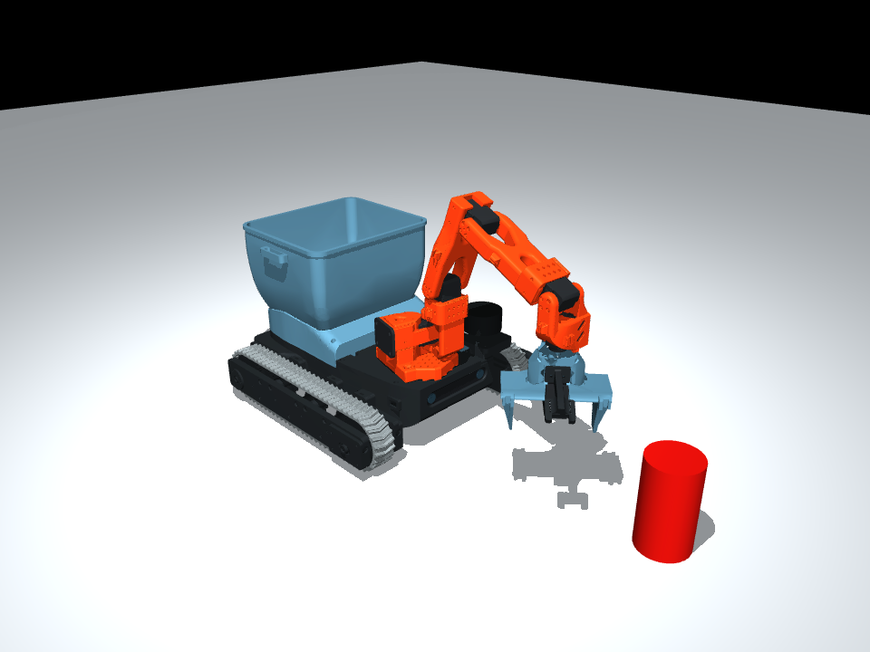

# MOSS V0.6 / R92 in MuJoCo

Open the released MOSS assembly, articulate its arm and gripper, and drive or
turn it on a flat surface. Everything needed to load the model is in this
folder. No Jev account, API key, dimOS installation or robot connection is needed.

**Status: preliminary simulation, not a calibrated digital twin.** Geometry is
tied to the R92 release. Real-world positioning error, grip force, traction and
payload capacity have not been measured against this model.



## Start

Use Python 3.12, then run these commands from this folder:

```sh
python3 -m venv .venv
.venv/bin/python -m pip install -r requirements.txt
```

Linux or Windows: run `python viewer.py` using that environment. On macOS,
MuJoCo's window needs its launcher:

```sh
.venv/bin/mjpython viewer.py
```

Use the MuJoCo control panel to move the five arm actuators and `nc90_close`.
`nc90_close` is travel per jaw: **0 opens to 90 mm; 0.045 closes the jaws**.
The two jaws and pinion are coupled. These are model commands, not servo ticks.

To drive forward or turn, pass left and right track speeds in metres/second:

```sh
.venv/bin/mjpython viewer.py --drive .08 .08
.venv/bin/mjpython viewer.py --drive -.04 .04
```

The same commands work without a window:

```sh
.venv/bin/python viewer.py --headless --seconds 3 --drive .08 .08
```

For import into another MuJoCo project, keep `model/meshes/` beside the XML:

```python
import mujoco

model = mujoco.MjModel.from_xml_path("model/moss_robot.xml")
data = mujoco.MjData(model)
mujoco.mj_resetDataKeyframe(model, data, model.key("home").id)
mujoco.mj_forward(model, data)
```

`moss_robot.xml` is the robot only. `scene.xml` adds the ground, lighting and a
free can-shaped test object. Paths are relative; downloading just the XML is
insufficient. Download or clone the repository to retain the mesh directory.

## What changed from the old demonstration

- Published **R92 hull, cover, mounts, wheel/frame parts, SO101 arm shells and
  NC90 gripper**, in assembly coordinates. The eight printed arm meshes retain
  their original geometry; they are not the low-poly TNKR guide conversions.
- **112 geometry parts/groups**, with source hashes and licences in
  [`model/manifest.json`](model/manifest.json). Manufacturer camera/electronics
  CAD is not redistributed; the visible sensors use simple identified envelopes.
- Forward/backward motion **and turning**, driven by a left/right speed interface.
  The former one-axis sliding base has been replaced by planar X/Y/yaw dynamics.
- **Coupled 90 mm gripper**, with explicit preliminary servo/gear parameters.
  Hinge friction inherited by the old pose inspector no longer prevents closure.
- CAD-based arm collisions and a decomposed **open bin**, rather than a single
  convex solid closing the bin's mouth. Collision geometry is in display group 3.
- Front and wrist **ideal cameras** and joint-position/velocity sensors, ready
  for software experiments. The cameras are not calibrated sensor replicas.
- Standalone viewer, local Python control and automated model checks.

## Coordinates and control

Metres, kilograms, seconds and radians. **+X forward, +Y left, +Z up**. The
ground is Z=0 at the saved R92 mounted belts. Their centres are 270 mm apart.
The CAD export origin was 24 mm above that ground plane; this translation is
recorded in `reference/kinematics.json`.

The model has 11 joint coordinates and 9 actuators. The full scene adds the
test object's free joint. Always look up joints and actuators by name:

| Interface | Meaning |
| --- | --- |
| `shoulder_pan`, `shoulder_lift`, `elbow_flex`, `wrist_flex`, `wrist_roll` | Arm position controls, radians |
| `nc90_close` | Travel of one jaw, metres |
| `base_vx`, `base_vy`, `base_wz` | World-frame planar velocity controls |
| `MossSimulation.drive(left, right)` | Converts ideal track speeds to forward motion/yaw using the current heading |
| `front_camera_ideal`, `wrist_camera_ideal` | Nominal perspective cameras |
| `tcp` | Nominal grasp-centre site; no measured tool calibration |

## Accuracy and limits

- **Locomotion is idealized.** The base stays on a fixed horizontal plane. Belts
  and wheels are rigid visual geometry, not rotating/deformable contact elements.
  No sand, slipping, track tension, motor current, slope or tipping prediction.
- **Dynamics are estimates.** Chassis mass/inertia, NC90 force and servo gains,
  friction and contact stiffness are not measurements of this MOSS. The SO101
  reference dynamics are upstream values, not calibration of this build.
- **Collisions are approximations.** Most static components use individual
  convex hulls. Small holes and cavities may be filled. The open-bin decomposition
  reached its 48-hull cap before achieving the requested 4 mm concavity target;
  that target is not an error guarantee. Connected arm and jaw interfaces have
  explicit contact exclusions. Loose cables, small fasteners and hull interiors
  are not comprehensively represented.
- **Vision is ideal.** Nominal camera placement/FOV, no measured lens distortion,
  RGB-D registration, noise or hand-eye calibration. Simulator state is ground
  truth, not a demonstration of autonomous litter detection.
- **Tests are software evidence.** They check loading, assets, basic motion,
  jaw coupling and a released object settling in the bin. They do not establish
  real-world grasp success or sim-to-real accuracy. No autonomous pickup mission
  is claimed by this package.

The estimates live in [`model/parameters.json`](model/parameters.json). These
are the items to replace with measured data as the calibrated model develops
with Dirac Robotics. Changes to collision shapes or physical parameters require
new tests; old Jev recordings are not claimed to transfer unchanged.

## Validate and rebuild

```sh
.venv/bin/python -m pip install -r requirements-dev.txt
.venv/bin/python -m pytest test_model.py -q
.venv/bin/python tools/build_model.py
```

`build_model.py` regenerates both XML files from the included manifest, geometry,
parameters and arm skeleton. Optional `tools/prepare_bin_collision.py` regenerates
the bin approximation and additionally needs `trimesh` and `coacd`; it is not
needed for normal use. See [`PROVENANCE.md`](PROVENANCE.md) for CAD source and
asset preparation. [`validation.json`](validation.json) records the checked scope.

## Licence

Code: Apache-2.0. MOSS-derived geometry: CERN-OHL-S-2.0. SO101 and NormaCore-derived
parts retain Apache-2.0. Documentation and preview: CC BY 4.0. See `NOTICE` and
the per-part manifest; this simulation folder does not replace the printable CAD.
